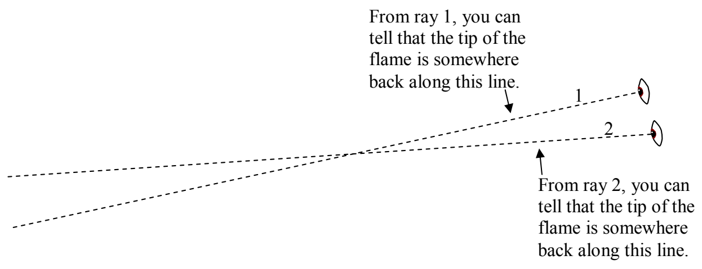

There is only one point in space that is both “somewhere back along line 1” and “somewhere back along line 2.” That one point is, of course, the point where the two lines cross. The eye-brain system is an amazing system. When you look at something, your eye-brain system automatically carries out the “trace back and find the intersection” process to determine how far away that something is. Again, you might not be able to tell me how many centimeters away the candle, for instance, is, but you must know how far away it is because you would know about how hard to throw something to hit the candle $^{1}$ .

This business of tracing rays back to see where they come from is known as ray tracing and is what geometric optics is all about.

At this point I want to return our attention to the candle to provide you with a little bit more insight into the practice of ray tracing. Suppose that when you were determining the location of the tip of the flame of the candle, you already had some additional information about the candle. For instance, assume: You know that the rays are coming from the upper extremity of the candle; you know that the bottom of the candle is on the plane of the surface of your dining room table; and you know that the candle is vertical. We’ll also assume that the candle is so skinny that we are not interested in its horizontal extent in space, so, we can think of it as a skinny line segment with a top (the tip of the candle) and a bottom, the point on the candle that is at table level. The intersection of the plane of the table surface with the plane of the two rays is a line, and, based on the information we have, the bottom of the candle is on that line.

$^{1}$  Note: Throwing things at lit candles is a dangerous practice in which I urge you not to engage.
