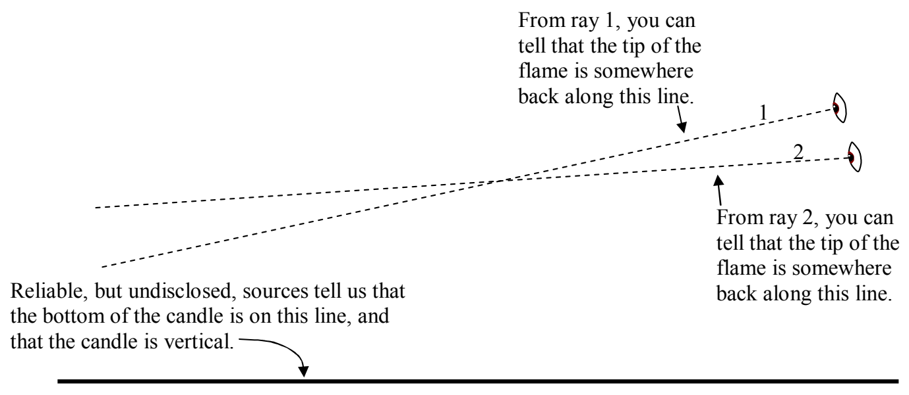
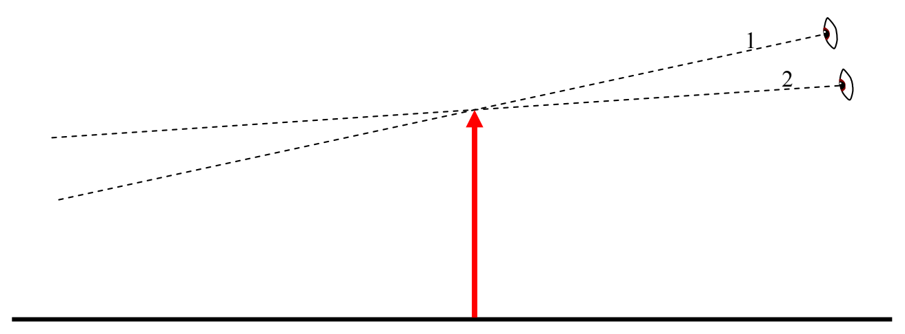

Taken together with the information gleaned from the rays, we can draw in the entire (skinny) candle, on our diagram, and from the diagram, determine such things as the candle's height, position, and orientation (whether it is upside down [inverted] or right side up [erect]). In adding the candle to the diagram, I am going to draw it as an arrow. Besides the fact that it is conventional to draw objects in ray tracing diagrams as arrows, we use an arrow to represent the candle to avoid conveying the impression that, from the limited facts we have at our disposal, we have been able to learn more about the candle (diameter, flame height, etc) than is possible. (We can only determine the height, position, and orientation.)

