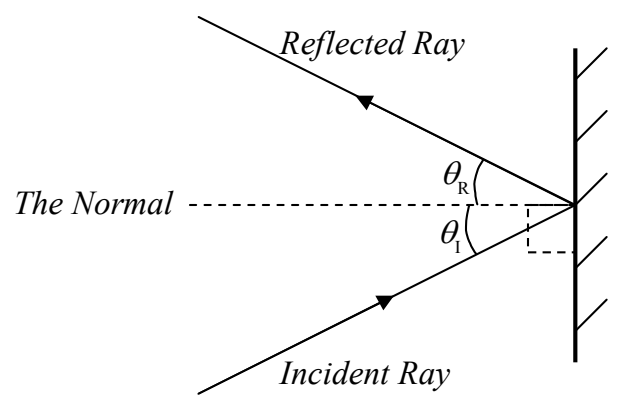

The trace-back method for locating the tip of the candle flame works for any two rays, from among the infinite number of rays emitted by the tip of the candle flame. All the rays come from the same point and they all travel along different straight line paths. As such, the rays are said to diverge from the tip of the candle flame. The trace-back method allows us to determine the point from which the rays are diverging.

By means of lenses and mirrors, we can redirect rays of light, infinite numbers of them at a time, in such a manner as to fool the eye-brain system that is using the trace-back method into perceiving the point from which the rays are diverging as being someplace other than where the object is. To do so, one simply has to redirect the rays so that they are diverging from someplace other than their point of origin. The point, other than their point of origin, from which the rays diverge (because of the redirection of rays by mirrors and/or lenses), is called the image of the point on the object from which the light actually originates.

## The Law of Reflection

I have mentioned specular reflection. In specular reflection, a ray of light traveling along one straight line path, hits a smooth shiny surface and continues along a new straight line path. The adoption of the new path, at the smooth shiny surface, by the incoming ray is called reflection. Where the ray travels along the new path, we call the ray, the reflected ray. The smooth shiny surface is typically called a mirror. The law of reflection, derived originally directly from experimental evidence and, by Huygens, from the principle now known as Huygens’ principle, states that the angle that the reflected ray makes with an imaginary line that is perpendicular to the mirror, and, passes through the point where the incoming ray hits the mirror, is equal to the angle that the incoming ray makes with the same imaginary line. The point where the incoming ray hits the mirror is called the point of incidence. The imaginary line that is perpendicular to the surface of the mirror and passes through the point of incidence is called the normal. The angle that the incoming ray makes with the normal is called the angle of incidence $\theta_{\mathrm{I}}$. The angle that the reflected ray makes with the normal is called the angle of reflection $\theta_{\mathrm{R}}$. In terms of this jargon, the law of reflection can be stated as: The angle of reflection $\theta_{\mathrm{R}}$ is equal to the angle of incidence $\theta_{\mathrm{I}}$.

The Law of Reflection states that $\theta_{\mathrm{R}} = \theta_{\mathrm{I}}$.
