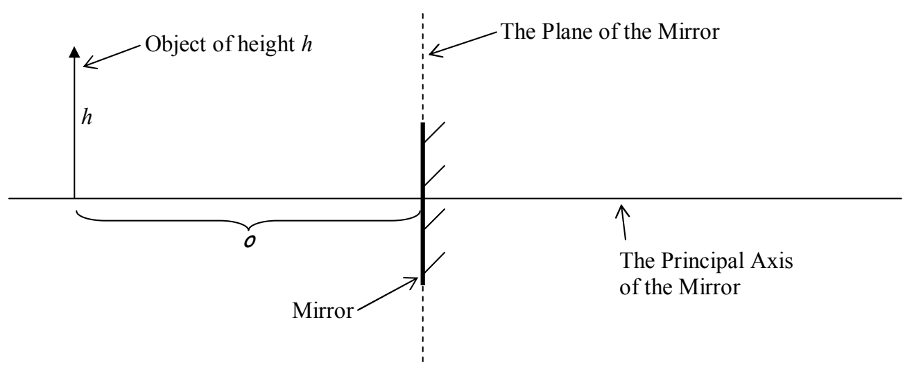
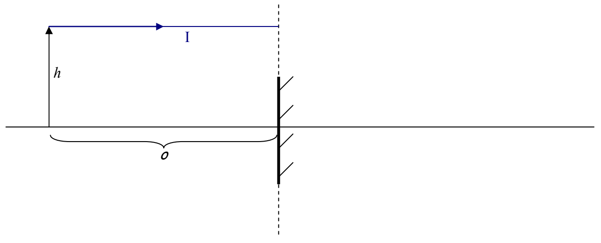

## Geometric Optics Applied to a Plane Mirror

Let's apply our ray-tracing methods to the case of an object in front of a plane mirror in order to determine the position of the image of that object. Here's the configuration.

We have an object of height h a distance o from the plane of the mirror. Our object is represented by an arrow. The tail of the arrow is on a reference line that is perpendicular to the plane of the mirror. I am calling the reference line “the principal axis of the mirror.” The plane of the mirror is the infinite plane that contains the surface of the mirror.

We use the method of principal rays to determine the position of the image of the object. In the method of principal rays, we consider only a few incident rays for which the reflected rays are particularly easy to determine. Experimentally, we find that the position of the image is independent of the size of the mirror, so we consider the mirror to be as large as it needs to be for the principal rays to hit it. In particular, if a principal ray appears to miss the mirror in our diagram, we show the ray as reflecting off the plane of the mirror nevertheless. Our Principal Ray I for the case at hand is one that approaches the plane of the mirror along a line that is parallel to the principal axis of the mirror.

