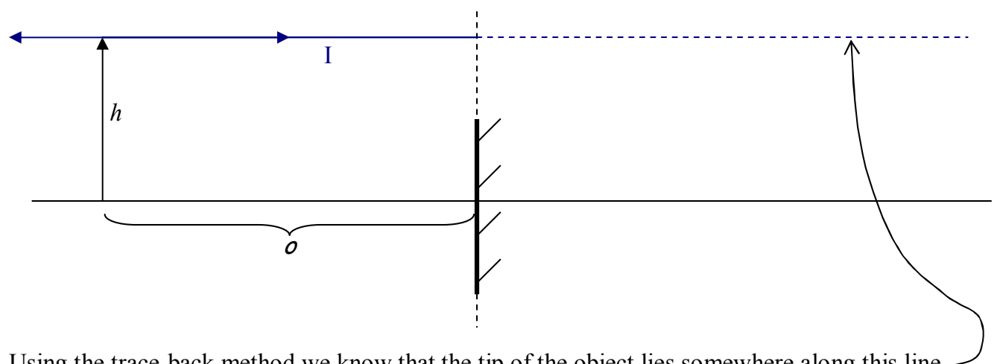
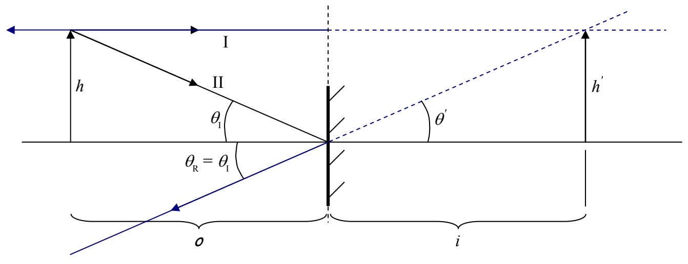

According to the law of reflection, Principal Ray I is reflected straight back on itself as depicted in the following diagram:

Using the trace-back method we know that the tip of the object lies somewhere along this line.

Principal Ray II hits the mirror right where the principal axis of the mirror intersects the mirror. In accord with the Law of Reflection, with, for the ray in question, the principal axis of the mirror being the normal, the reflected ray makes the same angle with the principal axis of the mirror as the incident ray does.

Tracing back the second reflected ray, to the point where it intersects the first reflected ray trace-back line, yields the position of the image of the tip of the arrow. I have drawn the shaft of the image of the arrow in so that it is perpendicular to the principal axis of the mirror. The question is, what is the image height  $h'$  and what is the distance of the image from the plane of the mirror? Well, the image height  $h'$  is the distance between the same two parallel lines that the object height h is the distance between. So,  $h' = h$ . Since vertical angles are equal, we have  $\theta'$  in the diagram above being equal to  $\theta_{R}$  which we know to be equal to  $\theta_{I}$  from the law of reflection. Thus the right triangle of side  $h'$  and angle  $\theta'$  is congruent to the triangle of height h and angle  $\theta_{I}$ . Hence, since corresponding sides of congruent triangles are equal, we have i = o. That is to say that the image distance, from the plane of the mirror, is equal to the object distance.
