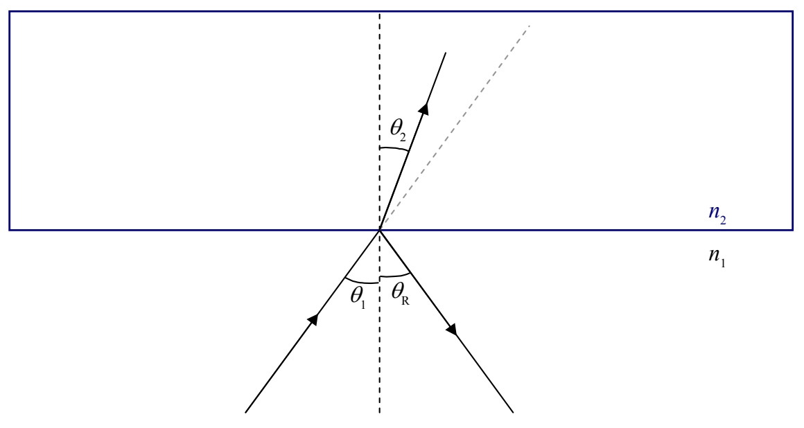
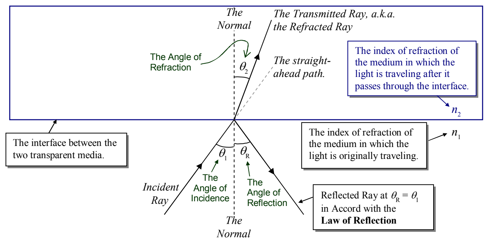

## 27 Refraction, Dispersion, Internal Reflection

When we talked about thin film interference, we said that when light encounters a smooth interface between two transparent media, some of the light gets through, and some bounces off. There we limited the discussion to the case of normal incidence. (Recall that *normal* means *perpendicular to* and normal incidence is the case where the direction in which the light is traveling is perpendicular to the interface.) Now we consider the case in which light shining on the smooth interface between two transparent media, is *not* normally incident upon the interface. Here’s a “clean” depiction of what I’m talking about:

and here’s one that’s all cluttered up with labels providing terminology that you need to know:

