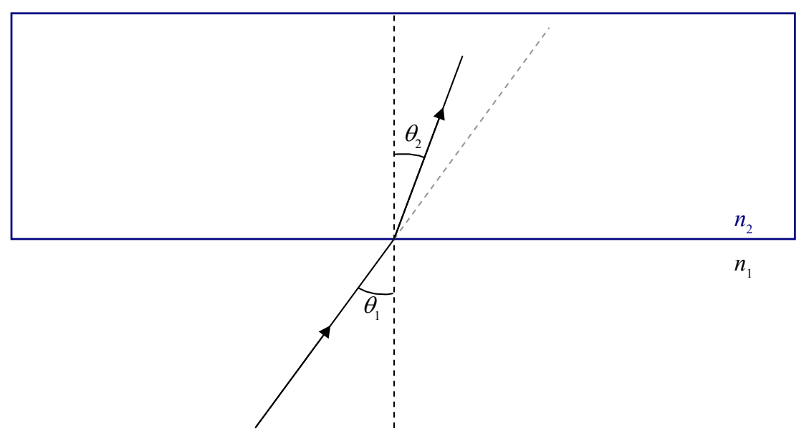

As in the case of normal incidence, some of the light is reflected and some of it is transmitted through the interface. Here we focus our attention on the light that gets through.

Experimentally we find that the light that gets through travels along a different straight line path than the one along which the incoming ray travels. As such, the transmitted ray makes an angle  $\theta_{2}$  with the normal that is different from the angle  $\theta_{1}$  that the incident ray makes with the normal.

The adoption of a new path by the transmitted ray, at the interface between two transparent media is referred to as refraction. The transmitted ray is typically referred to as the refracted ray, and the angle $\theta_{2}$ that the refracted ray makes with the normal is called the angle of refraction. Experimentally, we find that the angle of refraction $\theta_{2}$ is related to the angle of incidence $\theta_{1}$ by Snell's Law:

$$n _ {1} \sin \theta_ {1} = n _ {2} \sin \theta_ {2} \tag {27-1}$$

where:

$n_{1}$  is the index of refraction of the first medium, the medium in which the light is traveling before it gets to the interface,

$\theta_{1}$  is the angle that the incident ray (the ray in the first medium) makes with the normal,

$n_{2}$  is the index of refraction of the second medium, the medium in which the light is traveling after it goes through the interface, and,

$\theta_{2}$  is the angle that the refracted ray (the ray in the second medium) makes with the normal.
