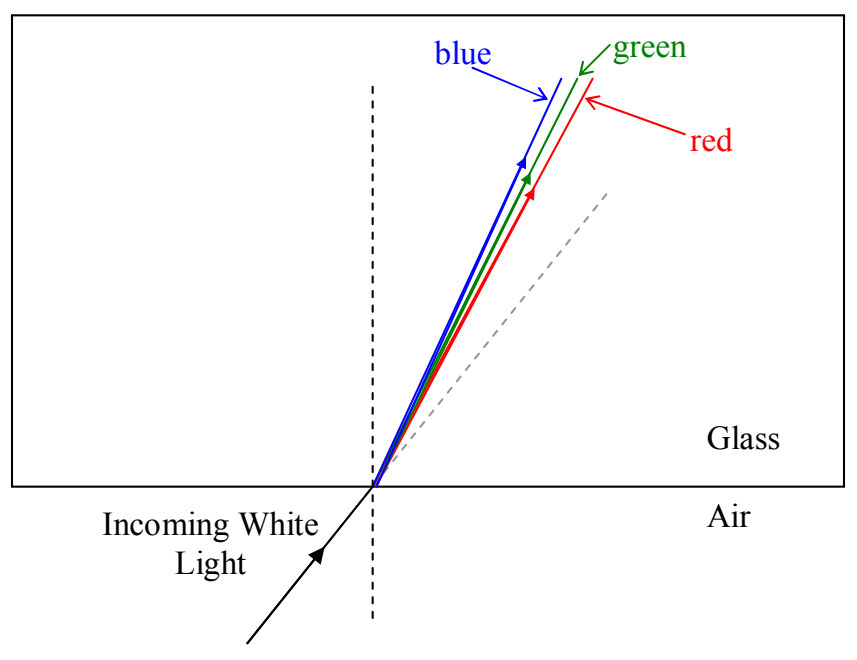

## Dispersion

On each side of the equation form of Snell's law we have an index of refraction. The index of refraction has the same meaning as it did when we talked about it in the context of thin film interference. It applies to a given medium. It is the ratio of the speed of light in that medium to the speed of light in vacuum. At that time, I mentioned that different materials have different indices of refraction, and in fact, provided you with the following table:

<table><tr><td>Medium</td><td>Index of Refraction</td></tr><tr><td>Vacuum</td><td>1</td></tr><tr><td>Air</td><td>1.00</td></tr><tr><td>Water</td><td>1.33</td></tr><tr><td>Glass (Depends on the kind of glass. Here is one typical value.)</td><td>1.5</td></tr></table>

What I didn't mention back then is that there is a slight dependence of the index of refraction on the wavelength of the visible light, such that, the shorter the wavelength of the light, the greater the index of refraction. For instance, a particular kind of glass might have an index of refraction of 1.49 for light of wavelength 695 nm (red light), but an index of refraction that is greater than that for shorter wavelengths, including an index of refraction of 1.51 for light of wavelength 405 nm (blue light). The effect in the case of a ray of white light traveling in air and encountering an interface between air and glass is to cause the different wavelengths of the light making up the white light to refract at different angles.

This phenomena of white light being separated into its constituent wavelengths because of the dependence of the index of refraction on wavelength, is called dispersion.
