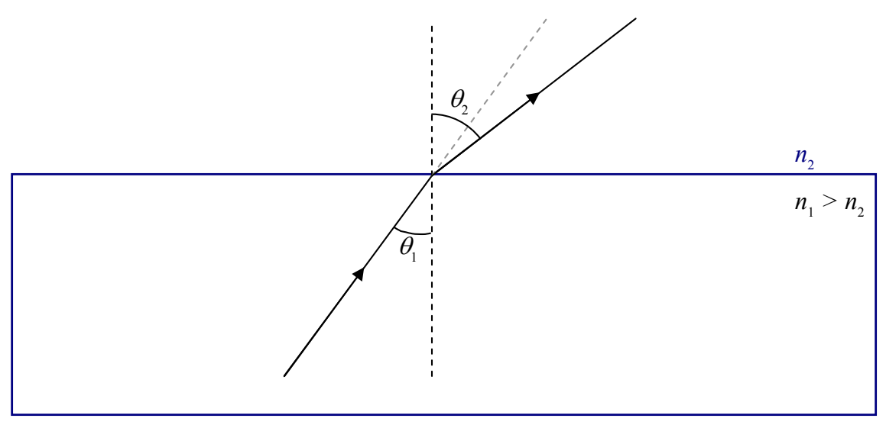
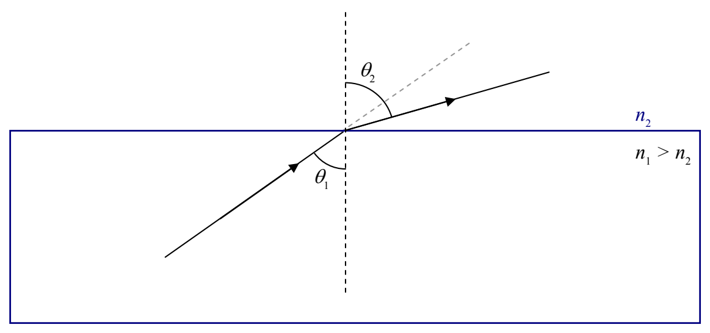

## Total Internal Reflection

In the case where the index of refraction of the first medium is greater than the index of refraction of the second medium, the angle of refraction is greater than the angle of incidence.

For such a case, look what happens when we increase the angle of incidence,  $\theta_{1}$ :

The angle of refraction gets bigger...
