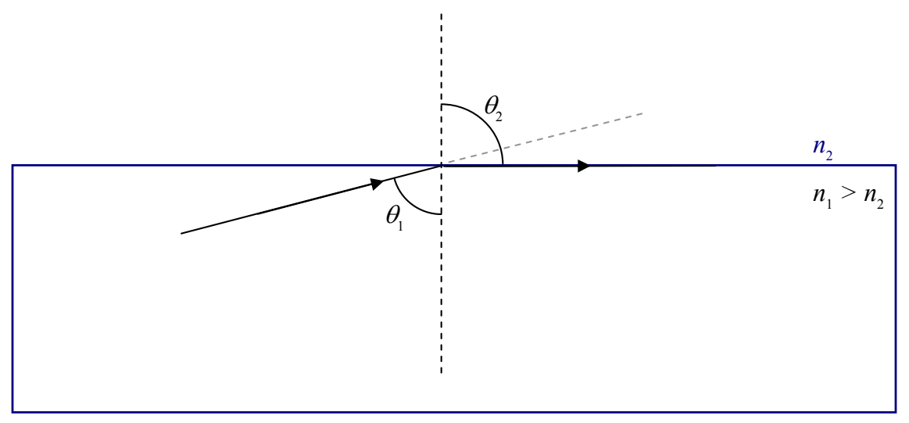

until eventually it (the angle of refraction) gets to be 90°.

It can’t get any bigger than that, because, beyond that, the light is not going through the interface. An angle of refraction greater than 90° has no meaning. But, note that we still have room to increase the angle of incidence. What happens if we continue to increase the angle of incidence? Well, indeed, no light gets through the interface. But, remember at the beginning of this chapter where we talked about how, when light is incident on the interface between two transparent media, some of the light gets through and some of it is reflected? Well, I haven’t been including the reflected ray on our diagrams because we have been focusing our attention on the transmitted ray, but, it is always there. The thing is, at angles of incidence bigger then the angle that makes the angle of refraction 90°, the reflected ray is all there is. The phenomenon, in which there is no transmitted light at all, just reflected light, is known as total internal reflection. The angle of incidence that makes the angle of refraction 90° is known as the critical angle. At any angle of incidence greater than the critical angle, the light experiences total internal reflection. Note that the phenomenon of total internal reflection only occurs when the light is initially in the medium with the bigger index of refraction.

Let’s investigate this phenomenon mathematically. Starting with Snell’s Law:

$$n_1 \sin \theta_1 = n_2 \sin \theta_2$$

solved for the sine of the angle of refraction:

$$\sin \theta_2 = \frac{n_1}{n_2} \sin \theta_1$$

we note that, since it was stipulated that $n_1 > n_2$, the ratio $n_1/n_2$ is greater than 1. The $\sin \theta_1$ is always less than 1, but, if $\theta_1$ is big enough, $\sin \theta_1$ can be so close to 1 that the right-hand side of
