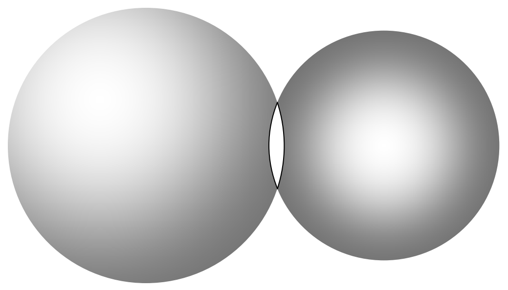
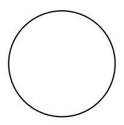
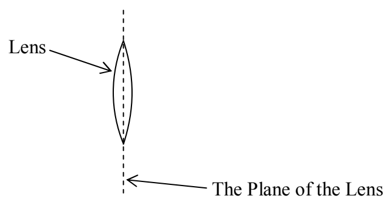

## 28 Thin Lenses: Ray Tracing

A lens is a piece of transparent material whose surfaces have been shaped so that, when the lens is in another transparent material (call it medium 0), light traveling in medium 0, upon passing through the lens, is redirected to create an image of the light source. Medium 0 is typically air, and lenses are typically made of glass or plastic. In this chapter we focus on a particular class of lenses, a class known as thin spherical lenses. Each surface of a thin spherical lens is a tiny fraction of a spherical surface. For instance, consider the two spheres:

A piece of glass in the shape of the intersection of these two spherical volumes would be a thin spherical lens. The intersection of two spherical surfaces is a circle. That circle would be the rim of the lens. Viewed face on, the outline of a thin spherical lens is a circle.

The plane in which that circle lies is called the plane of the lens. Viewing the lens edge-on, the plane of the lens looks like a line.

