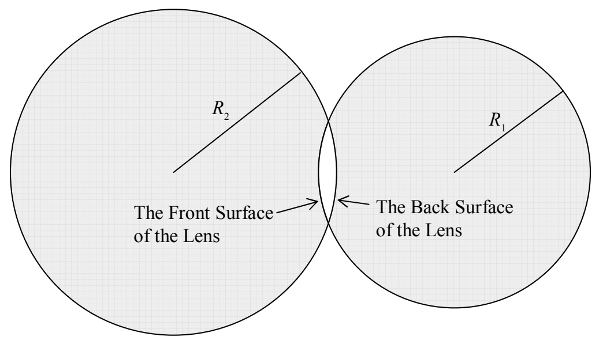

Each surface of a thin spherical lens has a radius of curvature. The radius of curvature of a surface of a thin spherical lens is the radius of the sphere of which that surface is a part. Designating one surface of the lens as the front surface of the lens and one surface as the back surface, in the following diagram:

we can identify $R_1$ as the radius of curvature of the front surface of the lens and $R_2$ as the radius of curvature of the back surface of the lens.

The defining characteristic of a lens is a quantity called the focal length of the lens. At this point, I’m going to tell you how you can calculate a value for the focal length of a lens, based on the physical characteristics of the lens, before I even tell you what focal length means. (Don’t worry, though, we’ll get to the definition soon.) The lens-maker’s equation gives the reciprocal of the focal length in terms of the physical characteristics of the lens (and the medium in which the lens finds itself):

*The Lens-Maker’s Equation:*

$$\frac{1}{f} = (n - n_o)\left(\frac{1}{R_1} + \frac{1}{R_2}\right) \tag{28-1}$$

where:

$f$ is the focal length of the lens,

$n$ is the index of refraction of the material of which the lens is made,

$n_o$ is the index of refraction of the medium surrounding the lens ($n_o$ is typically 1.00 because the medium surrounding the lens is typically air),

$R_1$ is the radius of curvature of one of the surfaces of the lens, and,

$R_2$ is the radius of curvature of the other surface of the lens.
