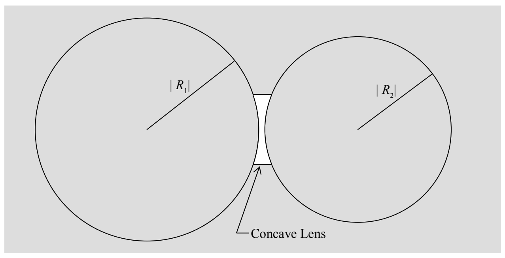
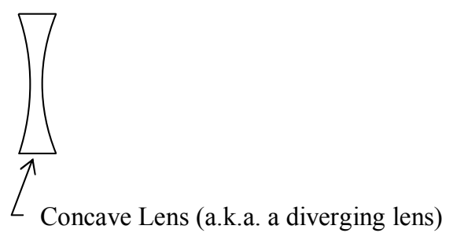

Before we move on from the lens-maker's equation, I need to tell you about an algebraic sign convention for the $R$ values. There are two kinds of spherical lens surfaces. One is the “curved out” kind possessed by any lens that is the intersection of two spheres. (This is the kind of lens that we have been talking about.) Such a lens is referred to as a convex lens (a.k.a. a converging lens) and each (“curved out”) surface is referred to as a convex surface. The radius of curvature $R$ for a convex surface is, by convention, positive.

The other kind of lens surface is part of a sphere that does not enclose the lens itself. Such a surface is said to be “curved in” and is called a concave surface.

By convention, the absolute value of R for a concave surface is still the radius of the sphere whose surface coincides with that of the lens. But, the quantity R contains additional information in the form of a minus sign used to designate the fact that the surface of the lens is concave. R is still called the radius of curvature of the surface of the lens despite the fact that there is no such thing as a sphere whose radius is actually negative.
