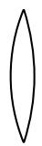
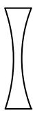
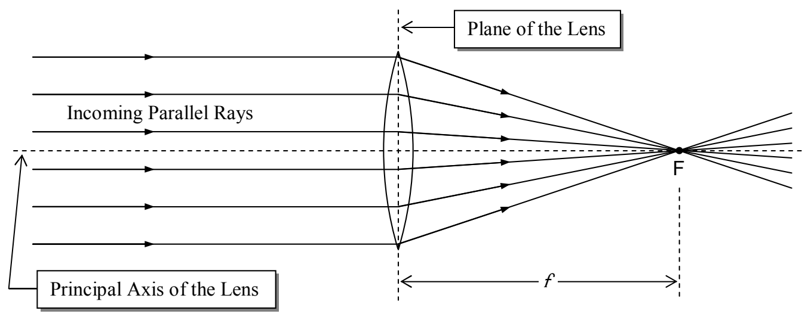

Summarizing, our convention for the radius of curvature of the surface of a lens is:

<table><tr><td>Surface of Lens</td><td>Algebraic Sign of Radius of Curvature R</td></tr><tr><td>Convex </td><td>+</td></tr><tr><td>Concave </td><td>-</td></tr></table>

So, what does a lens do? It refracts light at both surfaces. What's special about a lens is the effect that it has on an infinite set of rays, collectively. We can characterize the operational effect of a lens in terms of the effect that it has on incoming rays that are all parallel to the principal axis of the lens. (The principal axis of a lens is an imaginary line that is perpendicular to the plane of the lens and passes through the center of the lens.) A converging lens causes all such rays to pass through a single point on the other side of the lens. That point is the focal point F of the lens. Its distance from the lens is called the focal length f of the lens.

Note that in the diagram, we show the rays of light undergoing an abrupt change in direction at the plane of the lens. This is called the thin lens approximation and we will be using it in all our dealings with lenses. You know that the light is refracted twice in passing through a lens, once at the interface where it enters the lens medium, and again where it exits the lens medium. The two refractions together cause the incoming rays to travel in the directions in which they do travel. The thin lens approximation treats the pair of refractions as a single path change occurring at the
