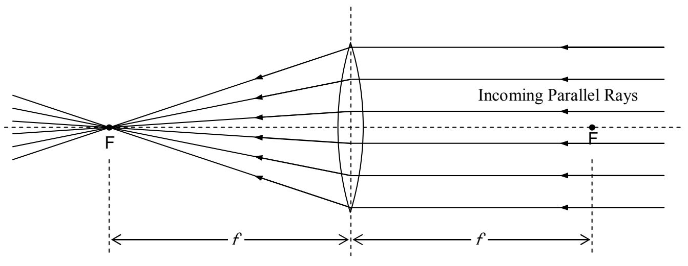
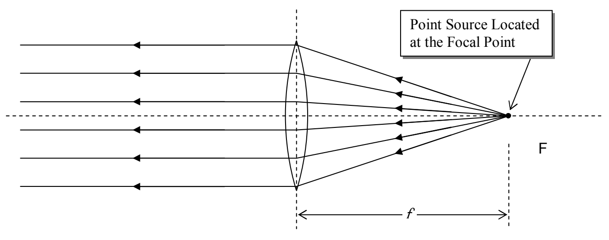

plane of the lens. The thin lens approximation is good as long as the thickness of the lens is small compared to the focal length, the object distance, and the image distance.

Rays parallel to the principal axis of the lens that enter the lens from the opposite direction (opposite the direction of the rays discussed above) will also be caused to converge to a focal point on the other side of the lens. The two focal points are one and the same distance f from the plane of the lens.

The two phenomena discussed above are reversible in the sense that rays of light coming from a point source, at either focal point, will result in parallel rays on the other side of the lens. Here we show that situation for the case of a point source at one of the focal points:

