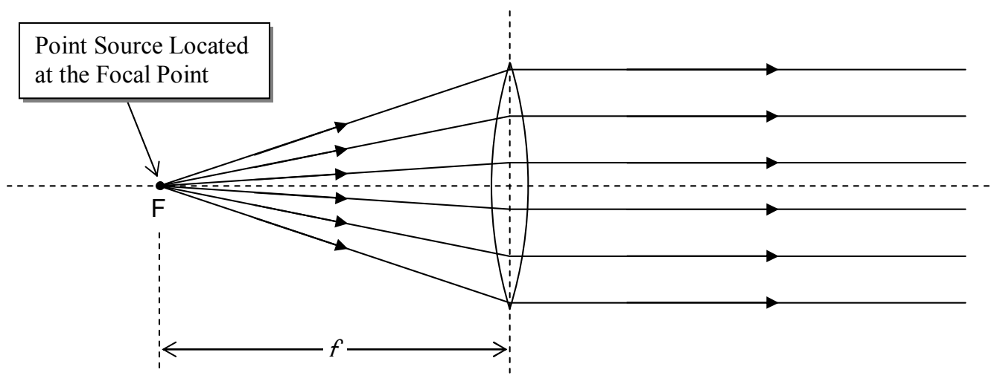
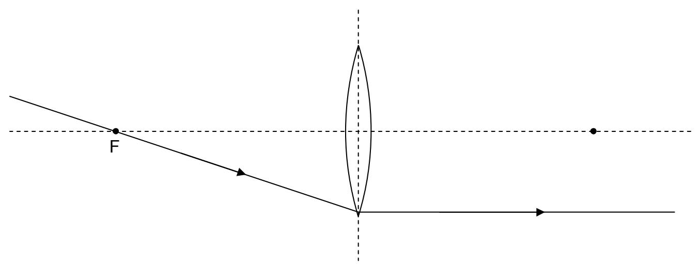

and here we show it for the case of a point source at the other focal point.

The important thing about this is that, any ray that passes through the focal point on its way to the lens is, after passing through the lens, going to be parallel to the principal axis of the lens.

