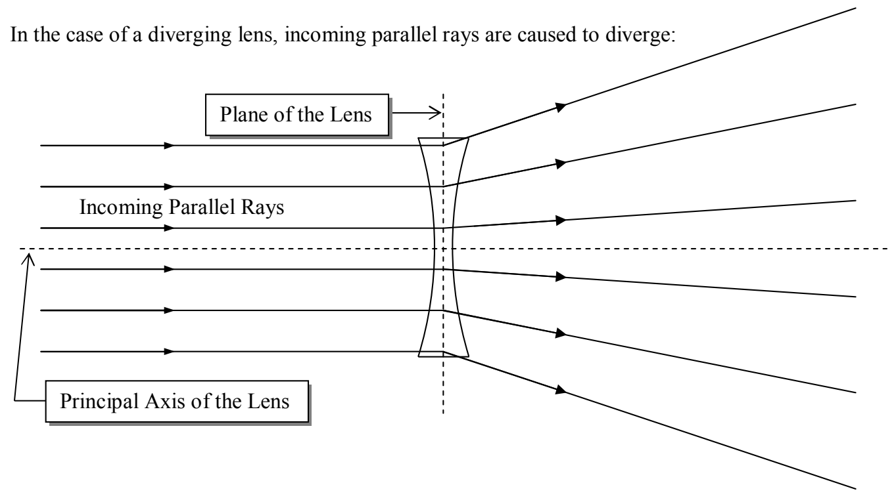
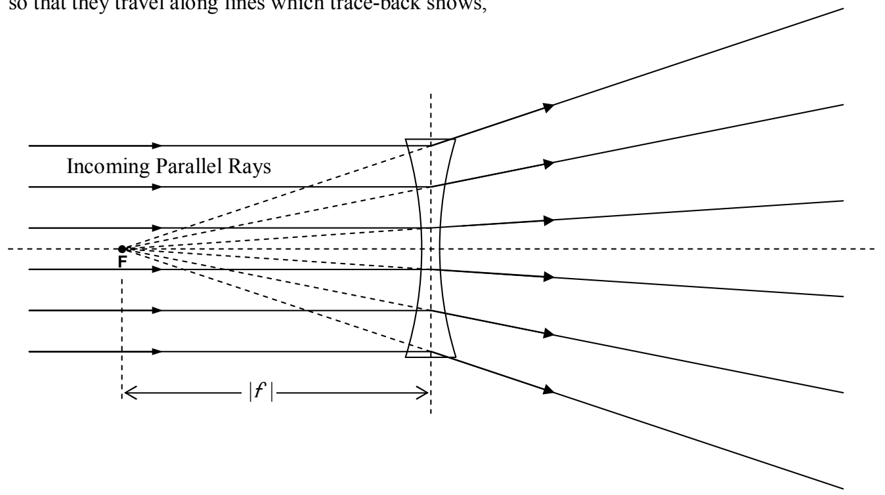

so that they travel along lines which trace-back shows,

all pass through one and the same point. That is, on passing through the lens, the once-parallel rays diverge as if they originated from a point. That point is known as the focal point of the diverging lens. The distance from the plane of the lens to the focal point is the magnitude of the focal length of the lens. But, by convention, the focal length of a diverging lens is negative. In other words, the focal length of a diverging lens is the negative of the distance from the plane of the lens to the focal point.
