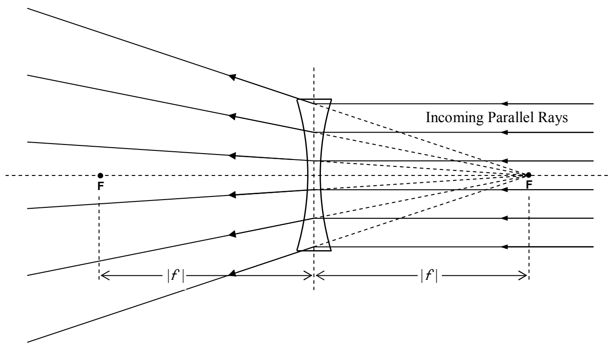
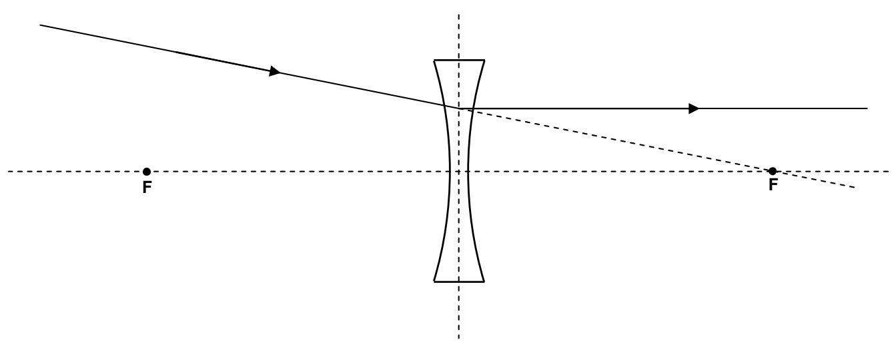

As in the case of the converging lens, there is another focal point on the other side of the lens, the same distance from the plane of the lens as the focal point discussed above:

This effect is reversible in that any ray that is traveling through space on one side of the lens, and is headed directly toward the focal point on the other side of the lens, will, upon passing through the lens, become parallel to the principal axis of the lens.

