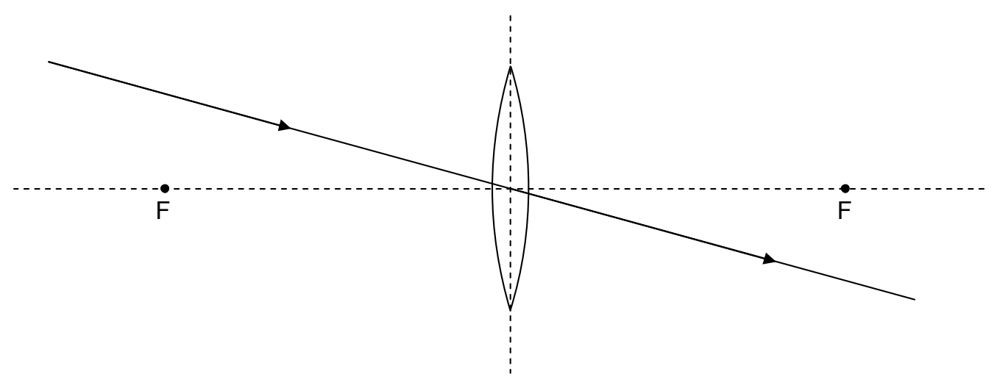
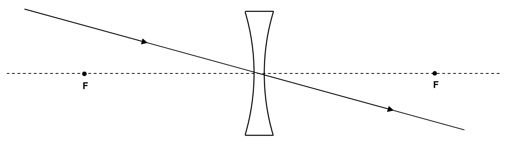

Our plan here is to use the facts about what a lens does to incoming rays of light that are parallel to the principal axis of a lens or are heading directly toward or away from a focal point, to determine where a lens will form an image of an object. Before we do that, I need to tell you one more thing about both kinds of thin spherical lenses. This last fact is a reminder that our whole discussion is an approximation that hinges on the fact that the lenses we are dealing with are indeed thin. Here’s the new fact: Any ray that is headed directly toward the center of a lens goes straight through. The justification is that at the center of the lens, the two surfaces of the lens are parallel. So, to the extent that they are parallel in a small region about the center of the lens, it is as if the light is passing through a thin piece of plate glass (or any transparent medium shaped like plate glass.) When light in air, is incident at some angle of incidence other than $0^{\circ}$, on plate glass, after it gets through both air/glass interfaces, the ray is parallel to the incoming ray. The amount by which the outgoing ray is shifted sideways, relative to the incoming ray, depends on how thick the plate is—the thinner the plate, the closer the outgoing ray is to being collinear with the incoming ray. In the thin lens approximation, we treat the outgoing ray as being exactly collinear with the incoming ray.

