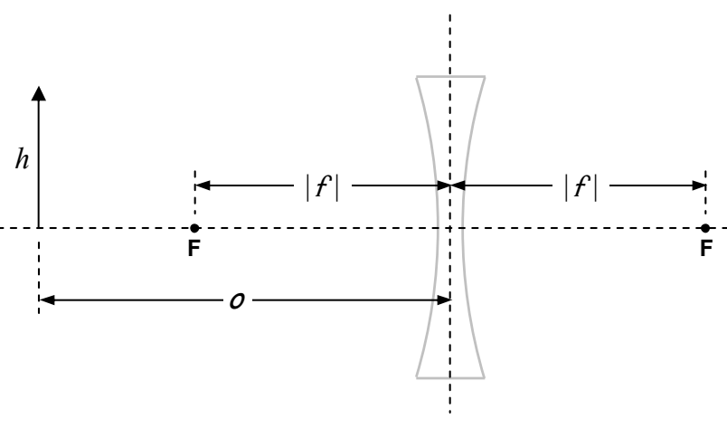
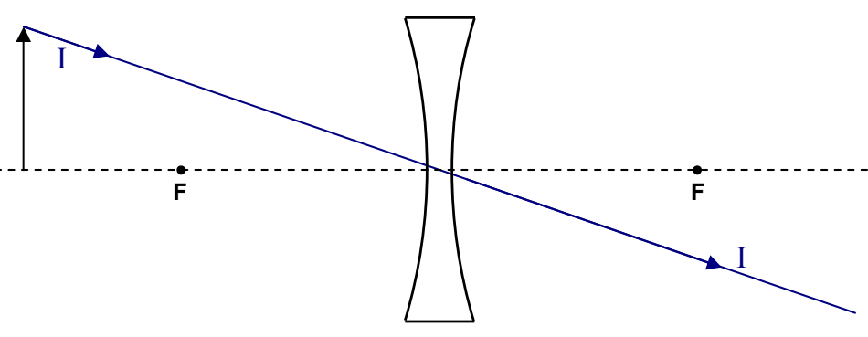

## Using Ray Tracing Diagrams

Given an object of height $h$, the object position $o$, and the focal length $f$ of the lens with respect to which the object position is given, you need to be able to diagrammatically determine: where the image of that object will be formed by the lens, how big the image is, whether the image is erect (right side up) or inverted (upside down), and whether the image is real or virtual (these terms will be defined soon). Here’s how you do that for the case of a diverging lens of specified focal length for which the object distance $o > |f|$:

Draw the plane of the lens and the principal axis of the lens. Draw the lens, but think of it as an icon, just telling you what kind of lens you are dealing with. As you proceed with the diagram be careful not to show rays changing direction at the surface of your icon. Also, make sure you draw a diverging lens if the focal length is negative. Measure off the distance $|f|$ to both sides of the plane of the lens and draw the focal points. Measure off the object distance $o$ from the plane of the lens, and, the height $h$ of the object. Draw in the object.

We determine the position of the image of the tip of the arrow by means of three principal rays. The three principal rays are rays on which the effect of the lens is easy to determine based on our understanding of what a lens does to incoming rays that are traveling toward the center of the lens, incoming rays that are traveling toward or away from a focal point, and incoming rays that are traveling directly toward the center of the lens. Let’s start with the easy one, Principal Ray I. It leaves the tip of the arrow and heads directly toward the center of the lens. It goes straight through.

