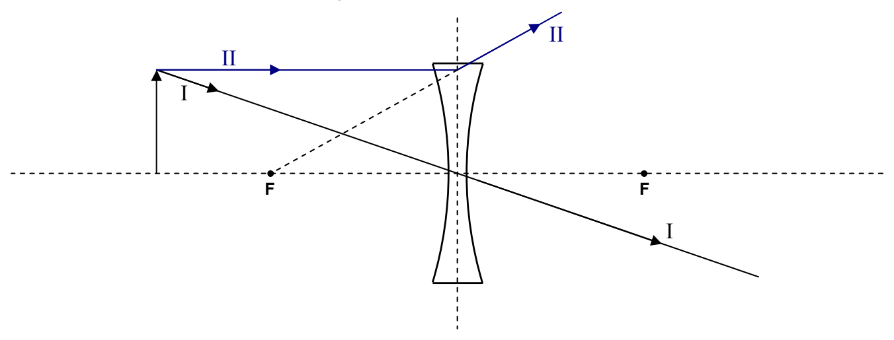
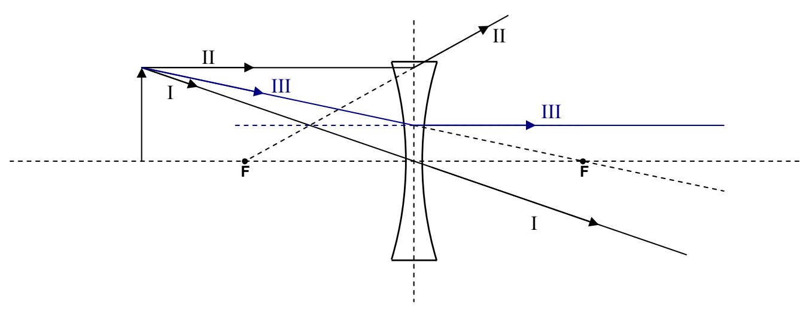

Next comes Principal Ray II. It comes in parallel to the principal axis of the lens, and, at the plane of the lens, jumps on a diverging line, which, if traced back, passes through the focal point on the same side of the lens as the object. Note the need for trace-back.

In the case of a diverging lens, Principal Ray III is the ray that, as it approaches the lens, is headed straight for the focal point on the other side of the lens. At the plane of the lens, Principal Ray III jumps onto a path that is parallel to the principal axis of the lens.

Note that, after passing through the lens, all three rays are diverging from each other. Trace-back yields the apparent point of origin of the rays, the image of the tip of the arrow. It is at the location where the three lines cross. (In practice, using a ruler and pencil, due to human error, the lines will cross at three different points. Consider these to be the vertices of a triangle and draw the tip of the arrow at what you judge to be the geometric center of the triangle.) Having located the image of the tip of the arrow, draw the shaft of the image of the arrow, showing that it extends from point of intersection, to the principal axis of the lens, and, that it is perpendicular to the principal axis of the lens.
