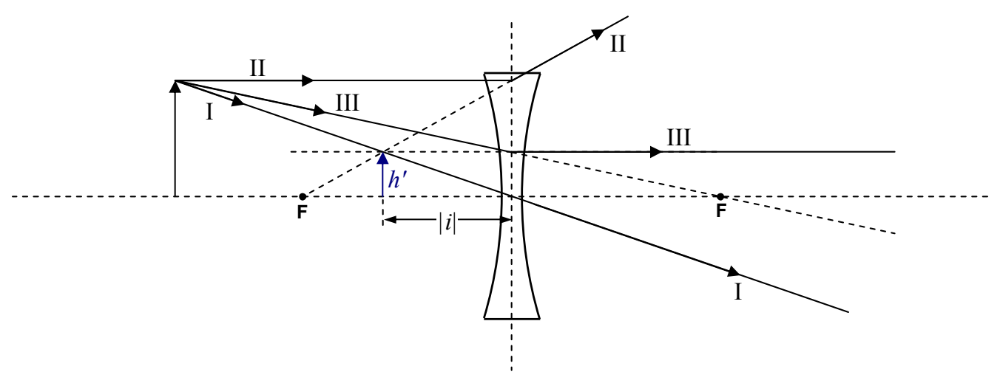
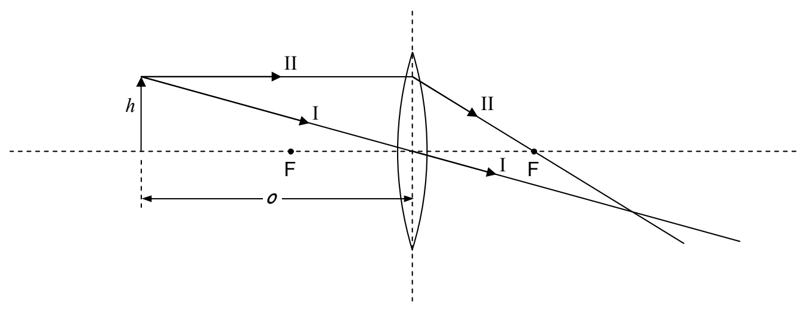

Measurements with a ruler yield the image height  $h'$  and the magnitude of the image distance  $|i|$ . The image is said to be a virtual image. A virtual image of a point, is a point from which rays appear to come, as determined by trace-back, but, through which the rays do not all, actually pass. By convention, the image distance is negative when the image is on the same side of the lens as the object. A negative image distance also signifies a virtual image. Note that the image is erect. By convention, an erect image has a positive image height  $h'$ . The magnification M is given by:

$$M = \frac {h ^ {\prime}}{h}$$

By convention, a positive value of M means the image is erect (right side up).

For the case of a converging lens, Principal Ray I is identical to the corresponding ray for the diverging lens. It starts out headed straight for the center of the lens, and, it goes straight through. Principal Ray II starts out the same way Principal Ray II did for the diverging lens—it comes in parallel to the principal axis of the lens—but, starting at the plane of the lens, rather than diverging, it is caused to converge to the extent that it passes through the focal point on the other side of the lens.

