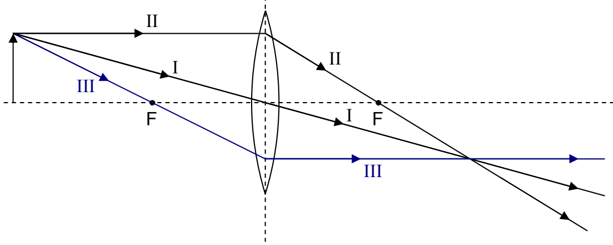
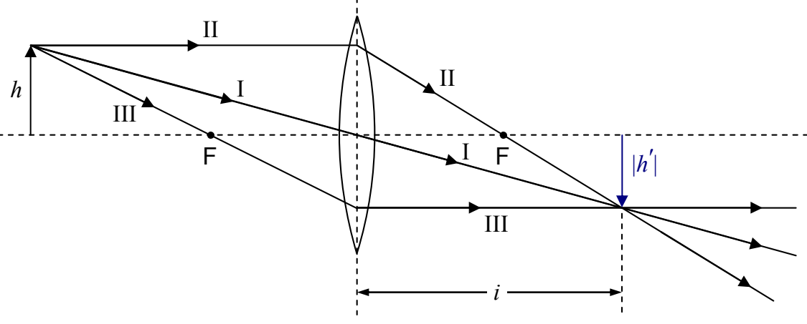

Principal Ray III, for a converging lens (with the object farther from the lens than the focal point is), passes through the focal point on the same side of the lens (the side of the lens the object is on) and then, when it gets to the plane of the lens, comes out parallel to the principal axis of the lens.

If you position yourself so that the rays, having passed through the lens, are coming at you, and, you are far enough away from the lens, you will again see the rays diverging from a point. But this time, all the rays actually go through that point. That is, the lens converges the rays to a point, and they don't start diverging again until after they pass through that point. That point is the image of the tip of the arrow. It is a real image. You can tell because if you trace back the lines the rays are traveling along, you come to a point through which all the rays actually travel. Identifying the crossing point as the tip of the arrow, we draw the shaft and head of the arrow.

This time, the image is inverted. We can measure the length of the image and the distance of the image from the plane of the mirror. By convention, the image height is negative when the image is inverted, and, the image distance is positive when the image is on the side of the lens opposite that of the object. The magnification M is again given by
