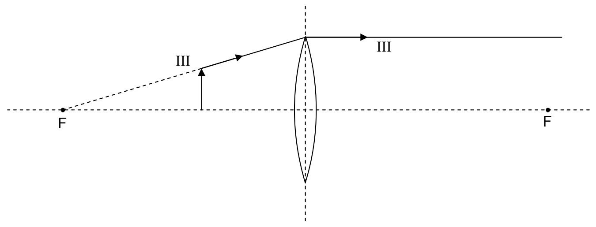

$$
M = \frac{h'}{h} \tag{28-2}
$$

which, with $h'$ being negative, turns out to be negative itself. This is consistent with the convention that a negative magnification means the image is inverted.

Principal Ray III is different for the converging lens when the object is closer to the plane of the lens than the focal point is:

Principal Ray III, like every principal ray, starts at the tip of the object and travels toward the plane of the lens. In the case at hand, on its way to the plane of lens, Principal Ray III travels along a line that, if traced back, passes through the focal point on the same side of the lens as the object.

This concludes our discussion of the determination of image features and position by means of ray tracing. In closing this chapter, I summarize the algebraic sign conventions, in the form of a table:

<table>
<tr><td>Physical Quantity</td><td>Symbol</td><td>Sign Convention</td></tr>
<tr><td>focal length</td><td>$f$</td><td>+ for converging lens – for diverging lens</td></tr>
<tr><td>image distance</td><td>$i$</td><td>+ for real image (on opposite side of lens as object) – for virtual image (on same side of lens as object)</td></tr>
<tr><td>image height</td><td>$h'$</td><td>+ for erect image – for inverted image</td></tr>
<tr><td>magnification</td><td>$M$</td><td>+ for erect image – for inverted image</td></tr>
</table>
