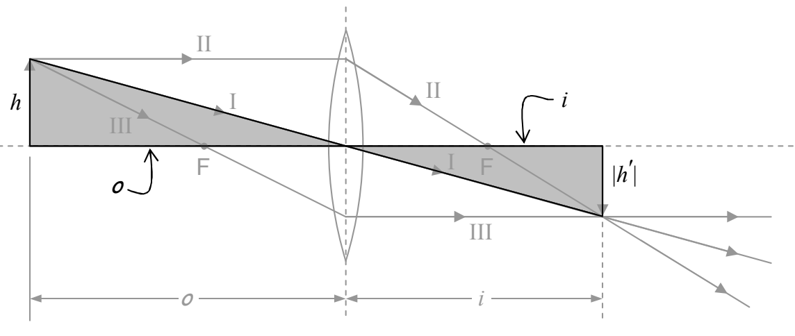

## 29 Thin Lenses: Lens Equation, Optical Power

From the thin lens ray-tracing methods developed in the last chapter, we can derive algebraic expressions relating quantities such as object distance, focal length, image distance, and magnification.

Consider for instance the case of a converging lens with an object more distant from the plane of the lens than the focal point is. Here's the diagram from the last chapter. In this copy, I have shaded two triangles in order to call your attention to them. Also, I have labeled the sides of those two triangles with their lengths.

By inspection, the two shaded triangles are similar to each other. As such, the ratios of corresponding sides are equal. Thus:

$$\frac {| h ^ {\prime} |}{h} = \frac {i}{o}$$

Recall the conventions stated in the last chapter:

<table><tr><td>Physical Quantity</td><td>Symbol</td><td>Sign Convention</td></tr><tr><td>focal length</td><td>$f$</td><td>+ for converging lens- for diverging lens</td></tr><tr><td>image distance</td><td>$i$</td><td>+ for real image- for virtual image</td></tr><tr><td>image height</td><td>$h'$</td><td>+ for erect image- for inverted image</td></tr><tr><td>magnification</td><td>$M$</td><td>+ for erect image- for inverted image</td></tr></table>

In the case at hand, we have an inverted image, so  $h'$  is negative, so  $|h'| = -h'$ . Thus, the equation  $\frac{|h'|}{h} = \frac{i}{o}$  can be written as  $\frac{-h'}{h} = \frac{i}{o}$ , or, as
