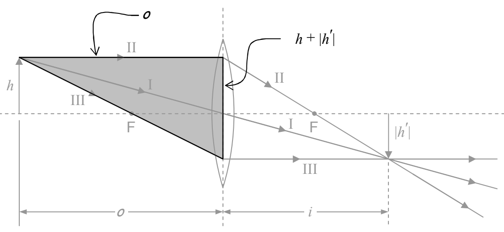
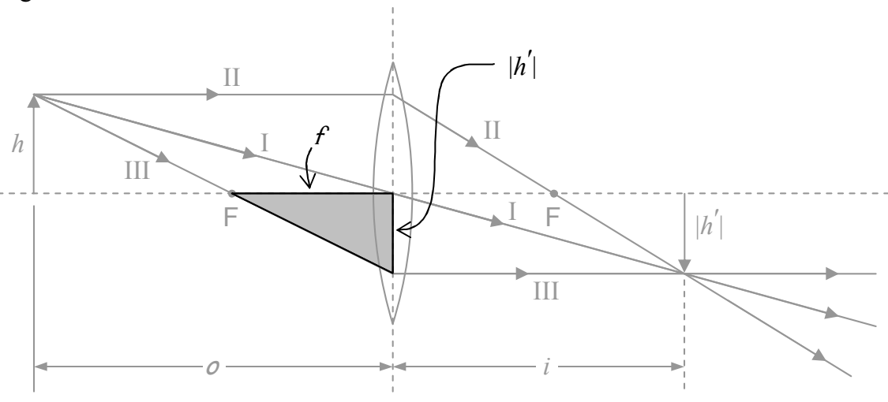

$$\frac{h'}{h} = -\frac{i}{o}$$

But $\frac{h'}{h}$ is, by definition, the magnification. Thus, we can write the magnification as:

$$M = -\frac{i}{o} \tag{29-1}$$

Here’s another copy of the same diagram with another triangle shaded.

By inspection, that shaded triangle is similar to the triangle that is shaded in the following copy of the same diagram:

Using the fact that the ratios of corresponding sides of similar triangles are equal, we set the ratio of the two top sides (one from each triangle) equal to the ratio of the two right sides:

$$\frac{o}{f} = \frac{h + |h'|}{|h'|}$$
