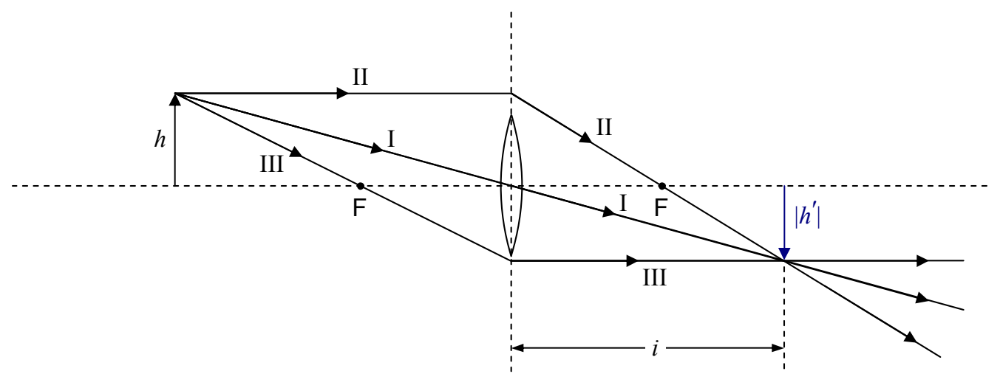
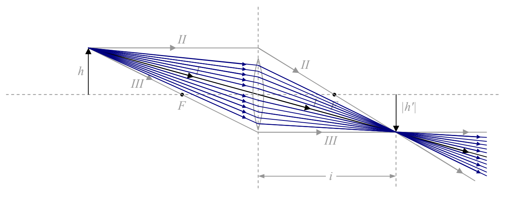

## An Important Conceptual Point

(We mentioned this in the last chapter but it warrants further attention.) An infinite set of rays contributes to any given point of an image formed by a lens. Consider for instance the case of an object at a greater distance than the focal length from a thin spherical convex (converging) lens. Further, because it's easy to specify, we will consider the image of the tip of the (arrow) object. We have been using the principal rays to locate the image, as in the following diagram:

in which I have intentionally used a small lens icon to remind you that, in using the principal ray diagram to locate the image, we don't really care whether or not the principal rays actually hit the lens. Let's, for the case at hand, consider the diagram to be a life-size diagram of an actual lens. As, important as they are in helping us identify the location of the image, clearly, for the case at hand, Principal Rays II and III do not actually contribute to the image. Principal Ray I does contribute to the image. Let's draw in some more of the contributors:

The fact that every ray that comes from the tip of the object and hits the lens contributes to the image of the tip of the arrow (and the corresponding fact for each and every point on the object) explains why you can cover up a fraction of the lens (such as half the lens) and still get a complete image (albeit dimmer).
