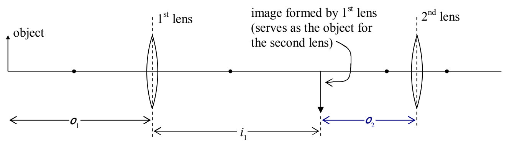
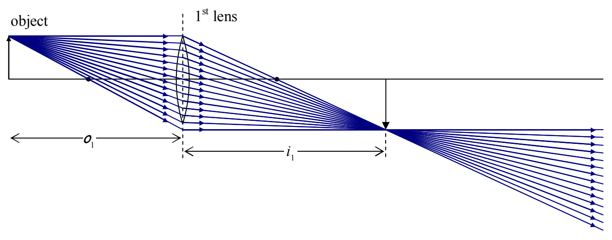

## Two-Lens Systems

To calculate the image of a two-lens system, one simply calculates the position of the image for the lens that light from the object hits first, and then uses that image as the object for the second lens. In general, one has to be careful to recognize that for the first lens, the object distance and the image distance are both measured relative to the plane of the first lens. Then, for the second lens, the object distance and the image distance are measured relative to the plane of the second lens. That means that, in general, the object distance for the second lens is not equal in value to the image distance for the first lens.

For instance, in the following diagram of two lenses separated by 12 cm, if the object is to the left of the first lens, and $i_1$ turns out to be 8 cm to the right of the first lens,

then $o_2$, the object distance for the second lens, is 4 cm. A peculiar circumstance arises when the second lens is closer to the first lens than the image formed by the first lens is. Suppose for instance, that we have the image depicted above, formed by the first lens:

Now suppose that we put a second lens in between the $1^{st}$ lens and the image.
