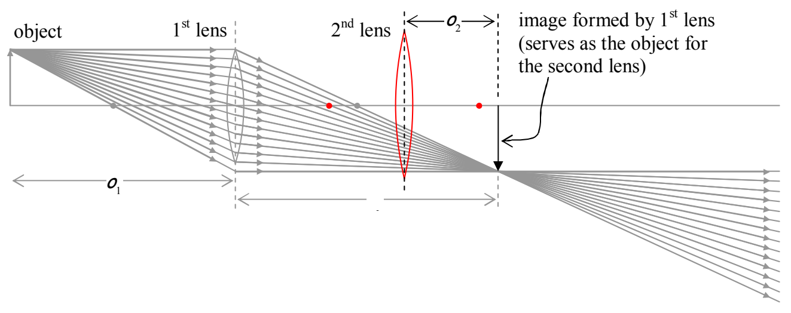
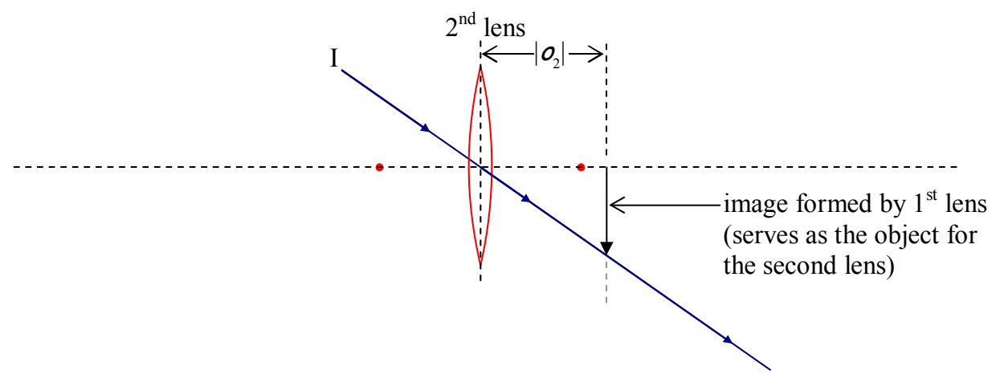

Note that, for the second lens, we have an object to the right of the lens, but, the light associated with that object approaches the object from the left! This can only happen when the object is actually an image formed by another lens. In such a case, we call the object a virtual object. More generally, when an object's light approaches a lens from the side opposite that side to which the object is, the object is considered to be a virtual object, and, the object distance, is, by convention, negative. So, we have one more convention to put in a table for you:

<table><tr><td>Physical Quantity</td><td>Symbol</td><td>Sign Convention</td></tr><tr><td>Object Distance</td><td>o</td><td>+ for real object (always the case for a physical object)– for virtual object (only possible if “object” is actually the image formed by another lens)</td></tr></table>

In forming the ray-tracing diagram for the case of the virtual object, we have to remember that every ray coming into the second lens is headed straight for the tip of the arrow that is the virtual object for the second lens. Thus, our Principal Ray I is one that is headed straight toward the tip of the arrow, and, is headed straight toward the center of the lens. It goes straight through.

