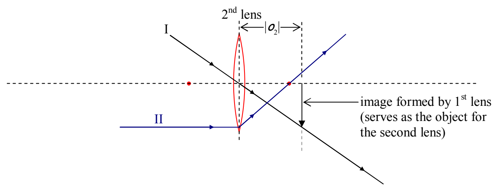
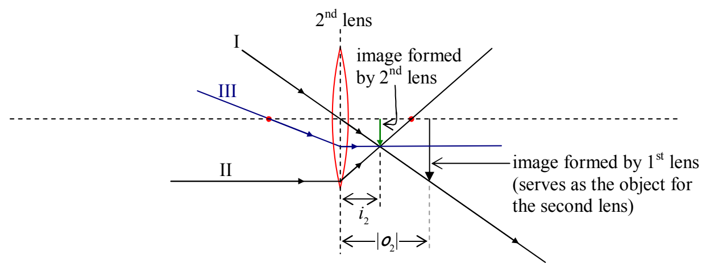

Principal Ray II is headed straight for the head of the object along a line that is parallel to the principal axis of the lens. At the plane of the lens it jumps onto the straight line path that takes it straight through the focal point on the other side of the lens.

Principal Ray III, is headed straight toward the tip of the virtual object, and, on its way to the lens, it passes through the focal point on the side of the lens from which it approaches the lens. When it hits the plane of the lens, Principal Ray III adopts a path that is parallel to the principal axis of the lens.

Note that, for the case at hand, we get a real image. Relative to the virtual object, the image is not inverted. The virtual object was already upside down. The fact that we can draw a ray-tracing diagram for the case of a virtual object means that we can identify and analyze similar triangles to establish the relationship between the object distance, the image distance and the focal length of the lens. Doing so, with the convention that the object distance of a virtual object is negative, again yields the lens equation  $\frac{1}{f}=\frac{1}{o}+\frac{1}{i}$ .

Here's a diagram of the entire two-lens system for the case at hand:
