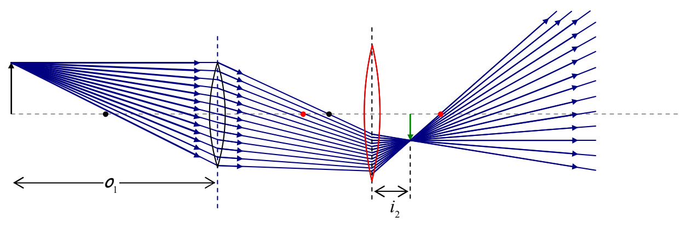
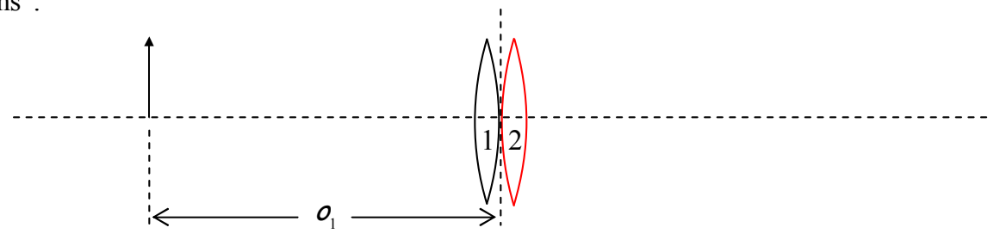

Note that the real image of lens 1 alone is never actually formed, but it was crucial in our determination of the image location, orientation, and size, in the case of the two-lens system.

## Two Lenses at (Essentially) the Same Location

In the thin lens approximation (in which we consider the thickness of a lens to be negligible), two lenses placed in contact with one another are considered to have one and the same “plane of the lens”.

As such, the object distance for the second lens is the negative of the image distance for the first lens. The second lens forms an image in accord with:

$$\frac{1}{f_2} = \frac{1}{\boldsymbol{o}_2} + \frac{1}{i_2}$$

in which, as we just stated, the object distance $o_2$ is the negative of the image distance $i_1$ for the first lens. Substituting $o_2 = -i_1$ yields

$$\frac{1}{f_2} = \frac{1}{-i_1} + \frac{1}{i_2}$$

$i_1$ represents the image distance for the image that would be formed by the first lens if the second lens wasn’t there. It is related to the focal length and object distance by the lens equation:

$$\frac{1}{f_1} = \frac{1}{o_1} + \frac{1}{i_1}$$
