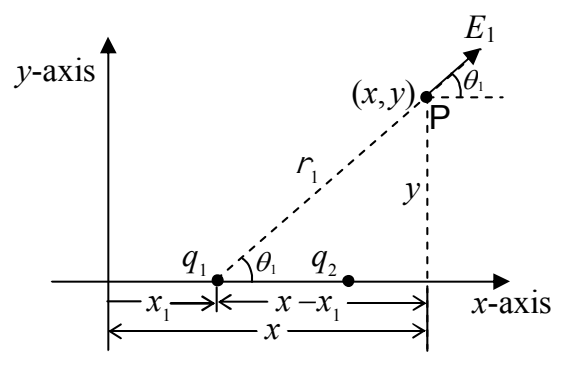
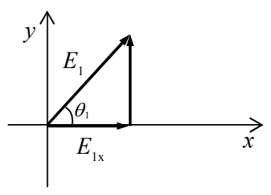
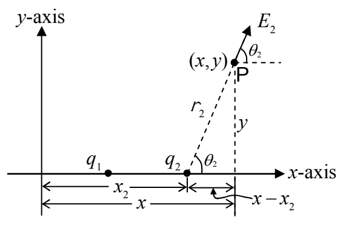

## Example 30-1 (A Review Problem)

There are two charged particles on the $x$-axis of a Cartesian coordinate system, $q_1$ at $x = x_1$ and $q_2$ at $x = x_2$ where $x_2 > x_1$. Find the $x$ component of the electric field, due to this pair of particles, valid for all points on the $x$-$y$ plane for which $x > x_2$.

$\vec{\mathbf{E}}_1$ is the contribution to the electric field at point P (at $x$, $y$) due to charge $q_1$. Charge $q_2$ contributes $\vec{\mathbf{E}}_2$ to the electric field at P.

$$\vec{\mathbf{E}} = \vec{\mathbf{E}}_1 + \vec{\mathbf{E}}_2$$

$$E_x = E_{1x} + E_{2x}$$

First, let’s get $E_{1x}$:

$$\frac{E_{1x}}{E_1} = \cos\theta_1$$

$$E_{1x} = E_1 \cos\theta_1$$

Looking at the diagram at the top of this column, we see that Coulomb’s Law for the Electric Field yields:

$$E_1 = \frac{kq_1}{r_1^2}$$

$$E_{1x} = \frac{kq_1}{r_1^2}\cos\theta_1$$

Again, from that first diagram,

$$r_1 = \sqrt{(x - x_1)^2 + y^2}$$

and

$$\cos\theta_1 = \frac{x - x_1}{r_1} = \frac{x - x_1}{\sqrt{(x - x_1)^2 + y^2}}$$

Substituting both of these into $E_{1x} = \frac{kq_1}{r_1^2}\cos\theta_1$ yields:

$$E_{1x} = \frac{kq_1}{\left(\sqrt{(x - x_1)^2 + y^2}\right)^2} \frac{x - x_1}{\sqrt{(x - x_1)^2 + y^2}}$$

$$E_{1x} = \frac{kq_1(x - x_1)}{\left[(x - x_1)^2 + y^2\right]^{3/2}}$$

It is left as an exercise for the reader to show that:

$$E_{2x} = \frac{kq_2(x - x_2)}{\left[(x - x_2)^2 + y^2\right]^{3/2}}$$

Since $E_x = E_{1x} + E_{2x}$, we have:

$$E_x = \frac{kq_1(x - x_1)}{\left[(x - x_1)^2 + y^2\right]^{3/2}} + \frac{kq_2(x - x_2)}{\left[(x - x_2)^2 + y^2\right]^{3/2}}$$
