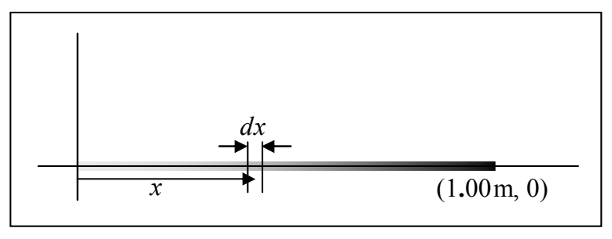

## Linear Charge Density

Okay, enough review, now lets consider the case in which we have a continuous distribution of charge along some line segment. In practice, we could be talking about a charged piece of string or thread, a charged thin rod, or even a charged piece of wire. First we need to discuss how one even specifies such a situation. We do so by stating what the linear charge density, the charge-per-length, $\lambda$ is. For now we'll consider the meaning of $\lambda$ for a few different situations (before we get to the heart of the matter, finding the electric field due to the linear charge distribution). Suppose for instance we have a one-meter string extending from the origin to $x = 1.00\mathrm{m}$ along the $x$ axis, and that the linear charge density on that string is given by:

$$\lambda = 2. 5 6 \frac {\mu \mathrm{C}}{\mathrm{m} ^ {2}} x.$$

(Just under the equation, we have depicted the linear charge density graphically by drawing a line whose darkness represents the charge density.)

Note that if the value of x is expressed in meters,  $\lambda$  will have units of  $\frac{\mu C}{m}$ , units of

charge-per-length, as it must. Further note that for small values of $x$, $\lambda$ is small, and for larger values of $x$, $\lambda$ is larger. That means that the charge is more densely packed near the far (relative to the origin) end of the string. To further familiarize ourselves with what $\lambda$ is, let's calculate the total amount of charge on the string segment. What we'll do is to get an expression for the amount of charge on any infinitesimal length $dx$ of the string, and add up all such amounts of charge for all of the infinitesimal lengths making up the string segment.

The infinitesimal amount of charge dq on the infinitesimal length dx of the string is just the charge per length  $\lambda$  times the length dx of the infinitesimal string segment.

$$d q = \lambda d x$$

Note that you can't take the amount of charge on a finite length (such as $15\mathrm{cm}$) of the string to be $\lambda$ times the length of the segment because $\lambda$ varies over the length of the segment. In the case of an infinitesimal segment, every part of it is within an infinitesimal distance of the position specified by one and the same value of $x$. The linear charge density doesn't vary on an infinitesimal segment because $x$ doesn't—the segment is simply too short.
