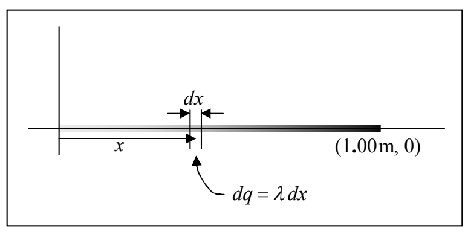

To get the total charge we just have to add up all the $dq$’s. Each $dq$ is specified by its corresponding value of $x$. To cover all the $dq$’s we have to take into account all the values of $x$ from 0 to 1.00 m. Because each $dq$ is the charge on an infinitesimal length of the line of charge, the sum is going to have an infinite number of terms. An infinite sum of infinitesimal pieces is an integral. When we integrate

$$dq = \lambda dx$$

we get, on the left, the sum of all the infinitesimal pieces of charge making up the whole. By definition, the sum of all the infinitesimal amounts of charge is just the total charge $Q$ (which by the way, is what we are solving for); we don’t need the tools of integral calculus to deal with the left side of the equation. Integrating both sides of the equation yields:

$$Q = \int_{0}^{1.00\mathrm{m}} \lambda dx$$

Using the given expression $\lambda = 2.56 \frac{\mu C}{m^2} x$ we obtain

$$Q = \int_{0}^{1.00\mathrm{m}} 2.56 \frac{\mu \mathrm{C}}{\mathrm{m}^2} x dx = 2.56 \frac{\mu \mathrm{C}}{\mathrm{m}^2} \int_{0}^{1.00\mathrm{m}} x dx = 2.56 \frac{\mu \mathrm{C}}{\mathrm{m}^2} \frac{x^2}{2} \bigg|_{0}^{1.00\mathrm{m}} = 2.56 \frac{\mu \mathrm{C}}{\mathrm{m}^2} \left[ \frac{(1.00\mathrm{m})^2}{2} - \frac{(0)^2}{2} \right] = 1.28\, \mu \mathrm{C}$$

A few more examples of distributions of charge follow:

For instance, consider charge distributed along the $x$ axis, from $x = 0$ to $x = L$ for the case in which the charge density is given by

$$\lambda = \lambda_{MAX} \sin (\pi \operatorname{rad} x / L)$$

where $\lambda_{MAX}$ is a constant having units of charge-per-length, rad stands for the units radians, $x$ is the position variable, and $L$ is the length of the charge distribution. Such a charge distribution has a maximum charge density equal to $\lambda_{MAX}$ occurring in the middle of the line segment.
