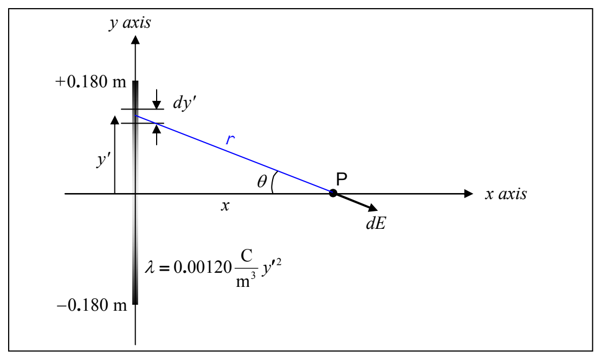

## Example 30-2

Find the electric field valid for any point on the positive $x$ axis due a 36.0 cm long line of charge, lying on the $y$ axis and centered on the origin, for which the charge density is given by

$$\lambda = 0.00120 \frac{\mathrm{C}}{\mathrm{m}^3} y^2$$

As usual, we’ll start our solution with a diagram:

Note that we use (and strongly recommend that you use) primed quantities $(x', y')$ to specify a point on the charge distribution and unprimed quantities $(x, y)$ to specify the empty point in space at which we wish to know the electric field. Thus, in the diagram, the infinitesimal segment of the charge distribution is at $(0, y')$ and point $\mathsf{P}$, the point at which we are finding the electric field, is at $(x, 0)$. Also, our expression for the given linear charge density $\lambda = 0.00120 \frac{\mathrm{C}}{\mathrm{m}^3} y^2$ expressed in terms of $y'$ rather than $y$ is:

$$\lambda = 0.00120 \frac{\mathrm{C}}{\mathrm{m}^3} y'^2$$

The plan here is to use Coulomb’s Law for the Electric Field to get the magnitude of the infinitesimal electric field vector $\mathbf{d}\overrightarrow{\mathbf{E}}$ at point $\mathsf{P}$ due to the infinitesimal amount of charge $dq$ in the infinitesimal segment of length $dy'$.

$$dE = \frac{k\, dq}{r^2}$$

The amount of charge $dq$ in the infinitesimal segment $dy'$ of the linear charge distribution is given by

$$dq = \lambda\, dy'$$
