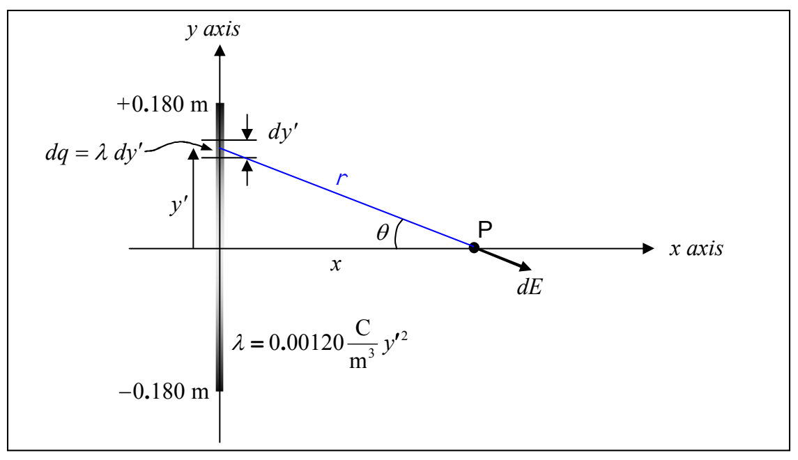
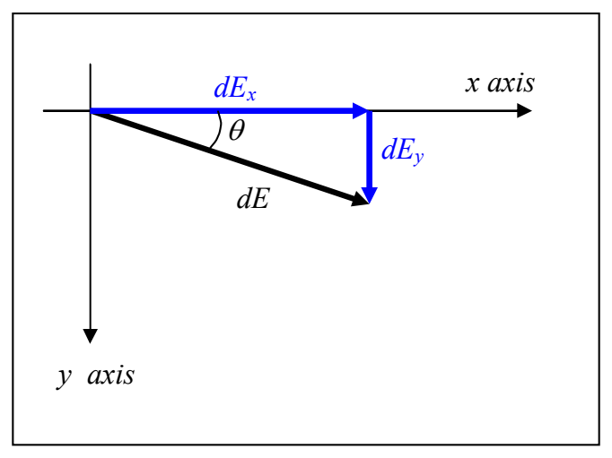

From the diagram, it clear that we can use the Pythagorean theorem to express the distance $r$ that point P is from the infinitesimal amount of charge $dq$ under consideration as:

$$r = \sqrt{x^2 + y'^2}$$

Substituting this and $dq = \lambda\, dy'$ into our equation for $dE$ ($dE = \frac{k\,dq}{r^2}$) we obtain

$$dE = \frac{k\,\lambda\, dy'}{x^2 + y'^2}$$

Recall that our plan is to find $E_\text{x}$, then $E_\text{y}$ and then put them together using $\vec{\mathbf{E}} = E_x\hat{\imath} + E_y\hat{\jmath}$. So for now, let’s get an expression for $E_\text{x}$.

Based on the vector component diagram at right we have

$$dE_x = dE\cos\theta$$

The $\theta$ appearing in the diagram at right is the same $\theta$ that appears in the diagram above. Based on the plane geometry evident in that diagram (above), we have:

$$\cos\theta = \frac{x}{r} = \frac{x}{\sqrt{x^2 + y'^2}}$$
