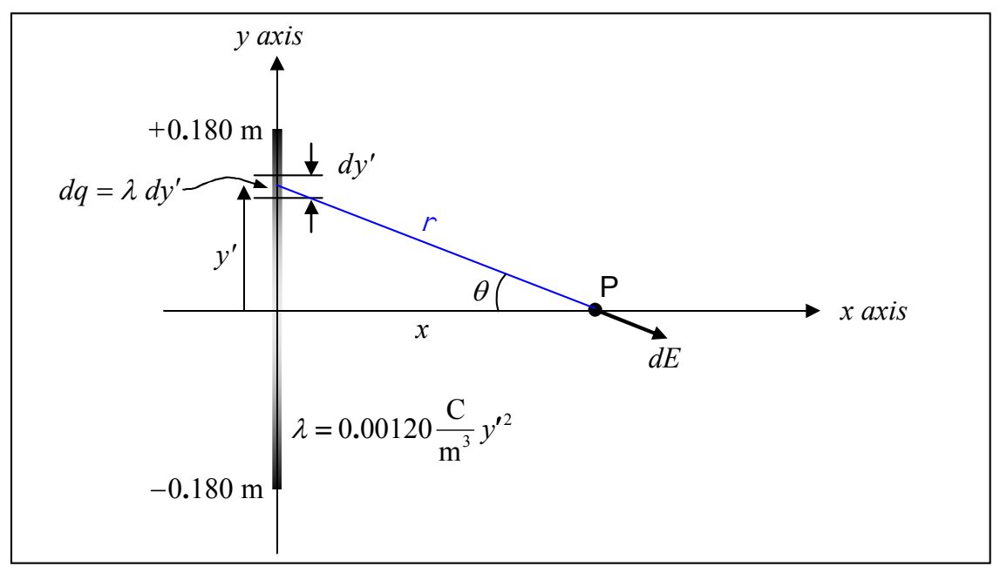

Substituting both this expression for $\cos\theta$ ($\cos\theta = \frac{x}{\sqrt{x^2 + y'^2}}$) and the expression we derived for $dE$ above ($dE = \frac{k\,\lambda\,dy'}{x^2 + y'^2}$) into our expression $dE_x = dE\cos\theta$ from the vector component diagram yields:

$$dE_x = \frac{k\,\lambda\,x\,dy'}{\left(x^2 + y'^2\right)^{3/2}}$$

Also, let’s go ahead and replace $\lambda$ with the given expression $\lambda = 0.00120\ \frac{\text{C}}{\text{m}^3}\,y'^2$ :

$$dE_x = \left(0.00120\ \frac{\text{C}}{\text{m}^3}\right) \frac{k\,y'^2\,x\,dy'}{\left(x^2 + y'^2\right)^{3/2}}$$

Now we have an expression for $dE_\text{x}$ that includes only one quantity, namely $y'$, that depends on which bit of the charge distribution is under consideration. Furthermore, although in the diagram

it appears that we picked out a particular infinitesimal line segment $dy'$, in fact, the value of $y'$ needed to establish its position is not specified. That is, we have an equation for $dE_\text{x}$ that is good for any infinitesimal segment $dy'$ of the given linear charge distribution. To identify a particular $dy'$ we just have to specify the value of $y'$. Thus to sum up all the $dE_\text{x}$’s we just have to add, to a running total, the $dE_\text{x}$ for each of the possible values of $y'$. Thus we need to integrate the expression for $dE_\text{x}$ for all the values of $y'$ from $-0.180\ \text{m}$ to $+0.180\ \text{m}$.

$$\int dE_x = \int_{-0.180\,\text{m}}^{+0.180\,\text{m}} \left(0.00120\ \frac{\text{C}}{\text{m}^3}\right) \frac{k\,y'^2\,x\,dy'}{\left(x^2 + y'^2\right)^{3/2}}$$
