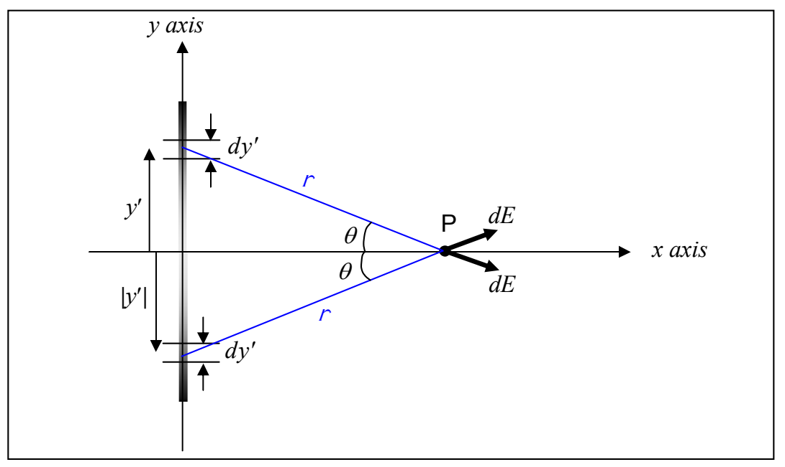

It is interesting to note that while the position variable $x$ (which specifies the location of the empty point in space at which the electric field is being calculated) is a constant for purposes of integration (the location of point $P$ does not change as we include the contribution to the electric field at point $P$ of each of the infinitesimal segments making up the charge distribution), an actual value $x$ was never specified. Thus our final result

$$E_x = 1.08 \times 10^7 \frac{N}{C \cdot m} x \cdot \left[ \frac{.360 m}{\sqrt{x^2 + (.180 m)^2}} + \ln \frac{\sqrt{x^2 + (.180 m)^2} + .180 m}{\sqrt{x^2 + (.180 m)^2} - .180 m} \right]$$

for $E_x$ is a function of the position variable $x$.

Getting the $y$-component of the electric field can be done with a lot less work than it took to get $E_x$ if we take advantage of the symmetry of the charge distribution with respect to the $x$ axis. Recall that the charge density $\lambda$, for the case at hand, is given by:

$$\lambda = 0.00120 \frac{C}{m^3} y'^2$$

Because $\lambda$ is proportional to $y'^2$, the value of $\lambda$ is the same at the negative of a specified $y'$ value as it is at the $y'$ value itself. More specifically, the amount of charge in each of the two same-size infinitesimal elements $dy'$ of the charge distribution depicted in the following diagram:

is one and the same value because one element is the same distance below the $x$ axis as the other is above it. This position circumstance also makes the distance $r$ that each element is from point $P$ the same as that of the other, and, it makes the two angles (each of which is labeled $\theta$ in the diagram) have one and the same value. Thus the two $\vec{dE}$ vectors have one and the same
