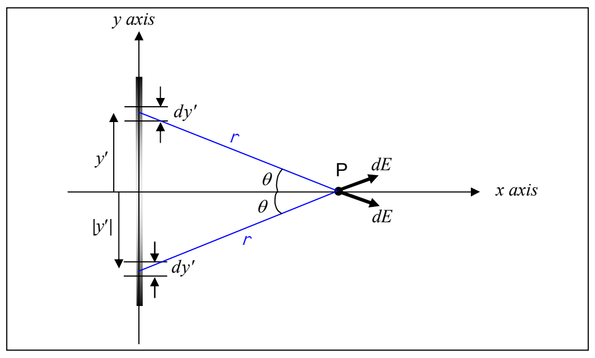

magnitude. As a result of the latter two facts (same angle, same magnitude of $\vec{\mathbf{dE}}$), the $y$ components of the two $\vec{\mathbf{dE}}$ vectors cancel each other out. As can be seen in the diagram under consideration:

one is in the $+y$ direction and the other in the $-y$ direction. The $y$ components are “equal and opposite.”) In fact, for each and every charge distribution element $dy'$ that is above the $x$ axis and is thus creating a downward contribution to the $y$ component of the electric field at point $P$, there is an element $dy'$ that is the same distance below the $x$ axis that is creating an upward contribution to the $y$ component of the electric field at point $P$, canceling the $y$ component of the former. Thus the net sum of all the electric field $y$ components (since they cancel pair-wise) is zero. That is to say that due to the symmetry of the charge distribution with respect to the $x$ axis, $E_{y} = 0$. Thus,

$$\vec{\mathbf{E}} = E_{x}\hat{\imath}.$$

Using the expression for $E_{x}$ that we found above, we have, for our final answer:

$$\boxed{\vec{\mathbf{E}} = 1.08 \times 10^{7} \frac{\mathrm{N}}{\mathrm{C} \cdot \mathrm{m}} x \left[ \frac{.360 \mathrm{m}}{\sqrt{x^{2} + (.180 \mathrm{m})^{2}}} + \ln \frac{\sqrt{x^{2} + (.180 \mathrm{m})^{2}} + .180 \mathrm{m}}{\sqrt{x^{2} + (.180 \mathrm{m})^{2}} - .180 \mathrm{m}} \right] \hat{\imath}}$$
