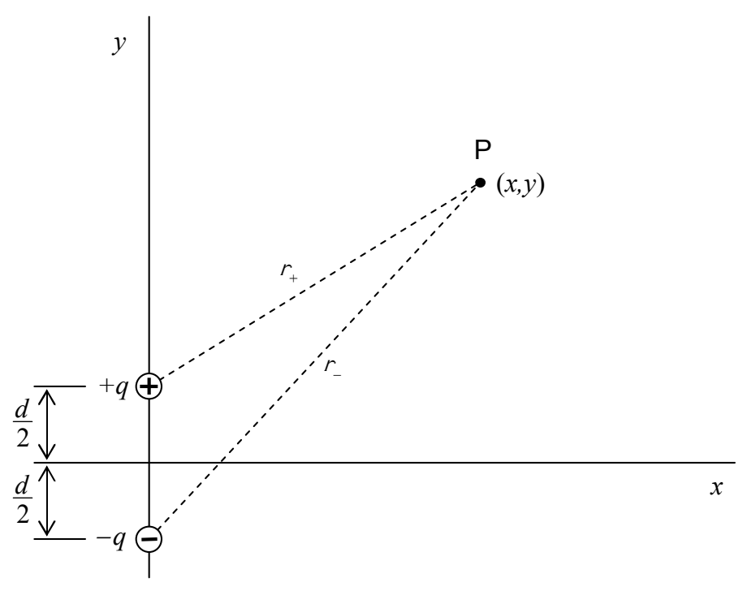

## Solution

We define a point P to be at some unspecified position  $(x,y)$ .

We call the distance from the positive charge to point P,  $r_{+}$ , and, we call the distance from the negative charge to point P,  $r_{-}$ . The electric potential due to a single point charge is given by  $\varphi = \frac{kq}{r}$ . Also, the contributions to the electric potential at one point in space due to more than one point charge simply add like numbers. So, we have:

$$\varphi = \varphi_ {1} + \varphi_ {2}$$

$$\varphi = \frac {k q}{r _ {+}} + \frac {k (- q)}{r _ {-}}$$

$$\varphi = \frac {k q}{r _ {+}} - \frac {k q}{r _ {-}}$$
