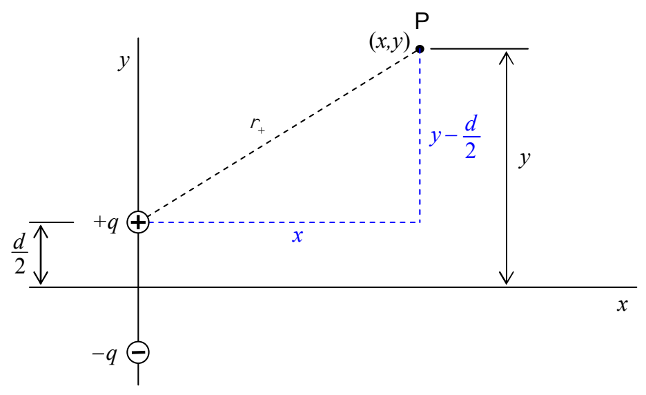
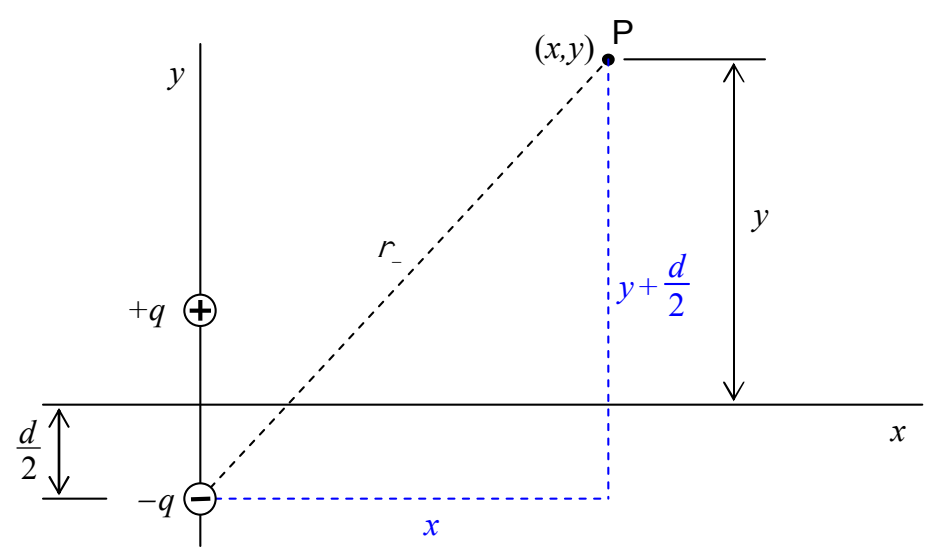

But, from the diagram:

we can determine that:

$$r _ {+} = \sqrt {x ^ {2} + \left(y - \frac {d}{2}\right) ^ {2}}$$

and from the diagram:

we can see that:

$$r _ {-} = \sqrt {x ^ {2} + \left(y + \frac {d}{2}\right) ^ {2}}$$
