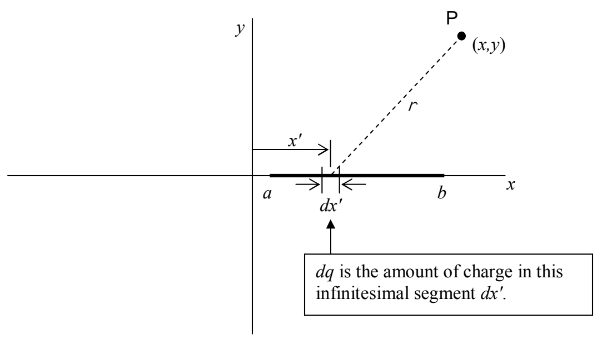

Plugging both of these results into our expression $\varphi = \frac{kq}{r_{+}} -\frac{kq}{r_{-}}$ yields:

$$\varphi = \frac {k q}{\sqrt {x ^ {2} + \left(y - \frac {d}{2}\right) ^ {2}}} - \frac {k q}{\sqrt {x ^ {2} + \left(y + \frac {d}{2}\right) ^ {2}}}$$

That's enough review. Please keep that $\varphi = \frac{kq}{r}$ formula in mind as we move on to the new stuff. Also keep in mind the fact that the various contributions to the electric potential at an empty point in space simply add (like numbers/scalars rather than like vectors).

The “new stuff” is the electric potential due to a continuous distribution of charge along a line segment. What we are dealing with is some line segment of charge. It can be anywhere, in any orientation, but for concreteness, let’s consider a line segment of charge on the x axis, say from some x = a to x = b where a < b. Furthermore, let’s assume the linear charge density (the charge-per-length) on the line segment to be some function  $\lambda(x')$ . The idea is to treat the charge distribution as an infinite set of point charges where each point charge may have a different charge value dq depending on where (at what value of  $x'$ ) it is along the line segment.

A particular infinitesimal segment of the line of charge, a length  $dx'$  of the line segment, will make a contribution

$$d \varphi = \frac {k d q}{r}$$

to the electric field at point P.
