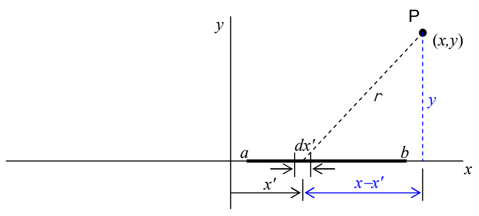

The amount of charge, $dq$, in the infinitesimal segment $dx'$ of the line of charge is just the charge-per-length $\lambda(x')$ (the linear charge density) times the length $dx'$ of the segment. That is to say that $dq = \lambda(x') dx'$. Substituting this into $d\varphi = \frac{k dq}{r}$ yields:

$$d\varphi = \frac{k \lambda(x') dx'}{r}$$

This is “$\lambda$ of $x'$.”

Applying the Pythagorean theorem to the triangle in the diagram:

tells us that $r$ can be written as $r = \sqrt{(x - x')^2 + y^2}$. Substituting this into our expression for $dV$ yields:

$$d\varphi = \frac{k \lambda(x') dx'}{\sqrt{(x - x')^2 + y^2}}$$

Integrating both sides yields:

$$\int d\varphi = \int_a^b \frac{k \lambda(x') dx'}{\sqrt{(x - x')^2 + y^2}}$$

$$\varphi = k \int_a^b \frac{\lambda(x') dx'}{\sqrt{(x - x')^2 + y^2}}$$

This is “$\lambda$ of $x'$.” Do not interpret it as $\lambda$ times $x'$.

This is the electric potential at point $P$ due to the charged line segment on the $x$ axis. Each bit of charge on the line segment is specified by its position variable $x'$. Thus, in summing the contributions to the electric potential due to each bit of charge, $x'$ is our variable of integration. While its position coordinates have not been specified, but rather, they have been designated $x$ and $y$, point $P$ is a fixed point in space. Hence, in summing up all the contributions to the electric potential at point $P$; $x$ and $y$ are to be considered constants. After the integral is done, however, because we never specified values for $x$ and $y$, the resulting expression for $\varphi$ can be considered to be a function of $x$ and $y$.
