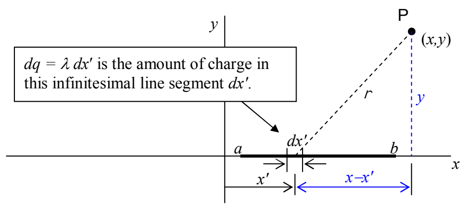

## Example 32-2

A line of charge extends along the x axis from $x = a$ to $x = b$. On that line segment, the linear charge density $\lambda$ is a constant. Find the electric potential as a function of position ($x$ and $y$) due to that charge distribution on the x-y plane, and then, from the electric potential, determine the electric field on the x axis.

**Solution:** First, we need to use the methods of chapter 31 to get the potential for the specified charge distribution (a linear charge distribution with a constant linear charge density $\lambda$).

$$d\varphi = \frac{k dq}{r}$$

$$dq = \lambda dx' \quad \text{and} \quad r = \sqrt{(x - x')^2 + y^2}$$

$$d\varphi = \frac{k \lambda (x') dx'}{\sqrt{(x - x')^2 + y^2}}$$

$$\int d\varphi = \int_a^b \frac{k \lambda dx'}{\sqrt{(x - x')^2 + y^2}}$$

$$\varphi = k \lambda \int_a^b \frac{dx'}{\sqrt{(x - x')^2 + y^2}}$$

To carry out the integration, we use the variable substitution:

$$u = x - x'$$

$$du = -dx' \Rightarrow dx' = -du$$

Lower Integration Limit: When $x' = a$, $u = x - a$

Upper Integration Limit: When $x' = b$, $u = x - b$

Making these substitutions, we obtain:

$$\varphi = k \lambda \int_{x-a}^{x-b} \frac{-du}{\sqrt{u^2 + y^2}}$$
