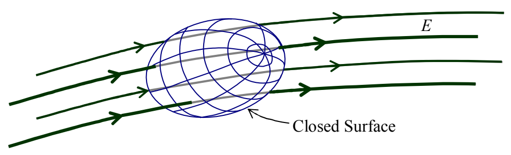

# 33 Gauss’s Law

When asked to find the electric flux through a closed surface due to a specified non-trivial charge distribution, folks all too often try the immensely complicated approach of finding the electric field everywhere on the surface and doing the integral of $\vec{E}$ dot $\vec{dA}$ over the surface instead of just dividing the total charge that the surface encloses by $\epsilon_{o}$.

Conceptually speaking, Gauss’s Law states that the number of electric field lines poking outward through an imaginary closed surface is proportional to the charge enclosed by the surface.

A closed surface is one that divides the universe up into two parts: inside the surface, and, outside the surface. An example would be a soap bubble for which the soap film itself is of negligible thickness. I’m talking about a spheroidal soap bubble floating in air. Imagine one in the shape of a tin can, a closed jar with its lid on, or a closed box. These would also be closed surfaces. To be closed, a surface has to encompass a volume of empty space. A surface in the shape of a flat sheet of paper would not be a closed surface. In the context of Gauss’s law, an imaginary closed surface is often referred to as a Gaussian surface.

In conceptual terms, if you use Gauss’s Law to determine how much charge is in some imaginary closed surface by counting the number of electric field lines poking outward through the surface, you have to consider inward-poking electric field lines as negative outward-poking field lines. Also, if a given electric field line pokes through the surface at more than one location, you have to count each and every penetration of the surface as another field line poking through the surface, adding $+1$ to the tally if it pokes outward through the surface, and $-1$ to the tally if it pokes inward through the surface.

So for instance, in a situation like:

we have 4 electric field lines poking inward through the surface which, together, count as $-4$ outward field lines, plus, we have 4 electric field lines poking outward through the surface which together count as $+4$ outward field lines for a total of 0 outward-poking electric field lines through the closed surface. By Gauss’s Law, that means that the net charge inside the Gaussian surface is zero.
