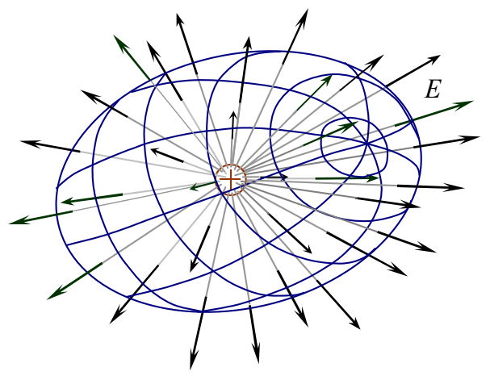
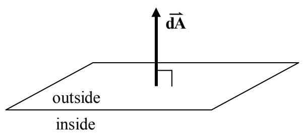

The following diagram might make our conceptual statement of Gauss’s Law seem like plain old common sense to you:

The closed surface has the shape of an egg shell. There are 32 electric field lines poking outward through the Gaussian surface (and zero poking inward through it) meaning there must (according to Gauss’s Law) be a net positive charge inside the closed surface. Indeed, from your understanding that electric field lines begin, either at positive charges or infinity, and end, either at negative charges or infinity, you could probably deduce our conceptual form of Gauss’s Law. If the net number of electric field lines poking out through a closed surface is greater than zero, then you must have more lines beginning inside the surface than you have ending inside the surface, and, since field lines begin at positive charge, that must mean that there is more positive charge inside the surface than there is negative charge.

Our conceptual idea of the net number of electric field lines poking outward through a Gaussian surface corresponds to the net outward electric flux $\Phi_E$ through the surface.

To write an expression for the infinitesimal amount of outward flux $d\Phi_E$ through an infinitesimal area element $dA$, we first define an area element vector $\vec{dA}$ whose magnitude is, of course, just the area $dA$ of the element; and; whose direction is perpendicular to the area element, and, outward. (Recall that a closed surface separates the universe into two parts, an inside part and an outside part. Thus, at any point on the surface, that is to say at the location of any infinitesimal area element on the surface, the direction outward, away from the inside part, is unambiguous.)

In terms of that area element, and, the electric field $\vec{E}$ at the location of the area element, we can write the infinitesimal amount of electric flux $d\Phi_E$ through the area element as:
