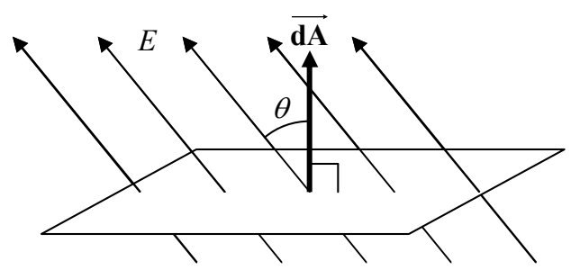

$$d\Phi_E = \vec{\mathbf{E}} \cdot \mathbf{\overrightarrow{dA}}$$

Recall that the dot product $\vec{E} \cdot d\vec{A}$ can be expressed as $E \, dA \cos \theta$. For a given $E$ and a given amount of area, this yields a maximum value for the case of $\theta = 0^{\circ}$ (when $\vec{E}$ is parallel to $d\vec{A}$ meaning that $\vec{E}$ is perpendicular to the surface); zero when $\theta = 90^{\circ}$ (when $\vec{E}$ is perpendicular to $d\vec{A}$ meaning that $\vec{E}$ is parallel to the surface); and; a negative value when $\theta$ is greater than $90^{\circ}$ (with $180^{\circ}$ being the greatest value of $\theta$ possible, the angle at which $\vec{E}$ is again perpendicular to the surface, but, in this case, into the surface.)

Now, the flux is the quantity that we can think of conceptually as the number of field lines. So, in terms of the flux, Gauss’s Law states that the net outward flux through a closed surface is proportional to the amount of charge enclosed by that surface. Indeed, the constant of proportionality has been established to be $\frac{1}{\epsilon_{\mathrm{o}}}$ where $\epsilon_{\mathrm{o}}$ (epsilon zero) is the universal constant known as the electric permittivity of free space. (You’ve seen $\epsilon_{\mathrm{o}}$ before. At the time, we stated that the Coulomb constant $k$ is often expressed as $\frac{1}{4\pi\epsilon_{\mathrm{o}}}$. Indeed, the identity $k = \frac{1}{4\pi\epsilon_{\mathrm{o}}}$ appears on your formula sheet.) In equation form, Gauss’s Law reads:

$$\oint \vec{\mathbf{E}} \cdot \vec{\mathbf{dA}} = \frac{Q_{\text{ENCLOSED}}}{\epsilon_{\mathrm{o}}} \tag{33-1}$$

The circle on the integral sign, combined with the fact that the infinitesimal in the integrand is an area element, means that the integral is over a closed surface. The quantity on the left is the sum of the product $\vec{E} \cdot d\vec{A}$ for each and every area element $dA$ making up the closed surface. It is the total outward electric flux through the surface.

$$\Phi_{\mathrm{E}} = \oint \vec{\mathbf{E}} \cdot \vec{\mathbf{dA}} \tag{33-2}$$

Using this definition in Gauss’s Law allows us to write Gauss’s Law in the form:

$$\Phi_{\mathrm{E}} = \frac{Q_{\text{ENCLOSED}}}{\epsilon_{\mathrm{o}}} \tag{33-3}$$
