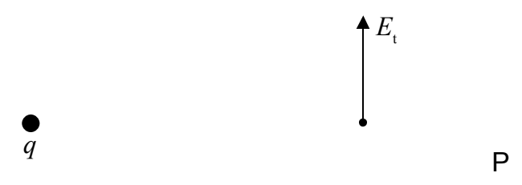

## Using Gauss's Law to Calculate the Electric Field in the Case of a Charge Distribution Having Spherical Symmetry

A spherically-symmetric charge distribution has a well-defined center. Furthermore, if you rotate a spherically-symmetric charge distribution through any angle, about any axis that passes through the center, you wind up with the exact same charge distribution. A uniform ball of charge is an example of a spherically-symmetric charge distribution. Before we consider that one, however, let's take up the case of the simplest charge distribution of them all, a point charge.

We use the symmetry of the charge distribution to find out as much as we can about the electric field and then we use Gauss's Law to do the rest. Now, when we rotate the charge distribution, we rotate the electric field with it. And, if a rotation of the charge distribution leaves you with the same exact charge distribution, then, it must also leave you with the same electric field.

We first prove that the electric field due to a point charge can have no tangential component by assuming that it does have a tangential component and showing that this leads to a contradiction.

Here's our point charge $q$, and an assumed tangential component of the electric field at a point $P$ which, from our perspective is to the right of the point charge.

(Note that a radial direction is any direction away from the point charge, and, a tangential direction is perpendicular to the radial direction.)
