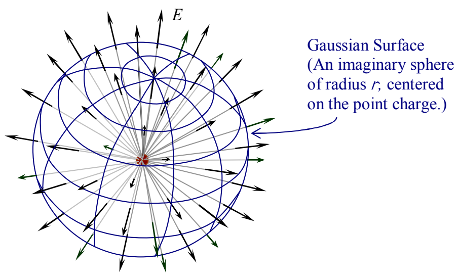

At this point we need to choose a Gaussian surface. To further exploit the symmetry of the charge distribution, we choose a Gaussian surface with spherical symmetry. More specifically, we choose a spherical shell of radius $r$, centered on the point charge.

At every point on the shell, the electric field, being radial, has to be perpendicular to the spherical shell. This means that for every area element, the electric field is parallel to our outward-directed area element vector $\vec{\mathbf{dA}}$. This means that the $\vec{\mathbf{E}} \cdot \vec{\mathbf{dA}}$ in Gauss's Law,

$$
\oint \vec{\mathbf{E}} \cdot \vec{\mathbf{dA}} = \frac{Q_{\text{ENCLOSED}}}{\epsilon_{\mathrm{o}}}
$$

evaluates to $EdA$. So, for the case at hand, Gauss's Law takes on the form:

$$
\oint E dA = \frac{Q_{\text{ENCLOSED}}}{\epsilon_{\mathrm{o}}}
$$

Furthermore, the magnitude of the electric field has to have the same value at every point on the shell. If it were different at a point $P'$ on the spherical shell than it is at a point $P$ on the spherical shell, then we could rotate the charge distribution about an axis through the point charge in such a manner as to bring the original electric field at point $P'$ to position $P$. But this would represent a change in the electric field at point $P$, due to the rotation, in violation of the fact that a point charge has spherical symmetry. Hence, the electric field at any point $P'$ on the Gaussian surface must have the same magnitude as the electric field at point $P$, which is what I set out to prove. The fact that $E$ is a constant, in the integral, means that we can factor it out of the integral. So, for the case at hand, Gauss's Law takes on the form:

$$
E \oint dA = \frac{Q_{\text{ENCLOSED}}}{\epsilon_{\mathrm{o}}}
$$
