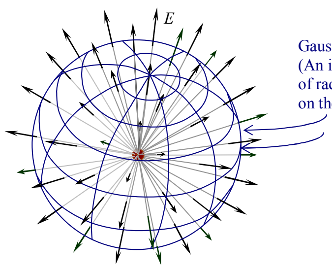

Gaussian Surface (An imaginary sphere of radius $r$, centered on the point charge.)

On the preceding page we arrived at $E \oint dA = \frac{Q_{\text{ENCLOSED}}}{\epsilon_{\mathrm{o}}}$.

Now $\oint dA$, the integral of $dA$ over the Gaussian surface is the sum of all the area elements making up the Gaussian surface. That means that it is just the total area of the Gaussian surface. The Gaussian surface, being a sphere of radius $r$, has area $4\pi r^2$. So now, Gauss’s Law for the case at hand looks like:

$$E 4\pi r^2 = \frac{Q_{\text{ENCLOSED}}}{\epsilon_{\mathrm{o}}}$$

Okay, we’ve left that right side alone for long enough. We’re talking about a point charge $q$ and our Gaussian surface is a sphere centered on that point charge $q$, so, the charge enclosed, $Q_{\text{ENCLOSED}}$ is obviously $q$. This yields:

$$E 4\pi r^2 = \frac{q}{\epsilon_{\mathrm{o}}}$$

Solving for $E$ gives us:

$$E = \frac{1}{4\pi \epsilon_{\mathrm{o}}} \frac{q}{r^2}$$

This is positive when the charge $q$ is positive, meaning that the electric field is directed outward, as per our assumption. It is negative when $q$ is negative. So, when the charge $q$ is negative, the electric field is directed inward, toward the charged particle. This expression is, of course, just Coulomb’s Law for the electric field. It may look more familiar to you if we write it in terms of the Coulomb constant $k = \frac{1}{4\pi \epsilon_{\mathrm{o}}}$ in which case our result for the outward electric field appears as:

$$E = \frac{kq}{r^2}$$

It’s clear that, by means of our first example of Gauss’s Law, we have derived something that you already know, the electric field due to a point charge.
